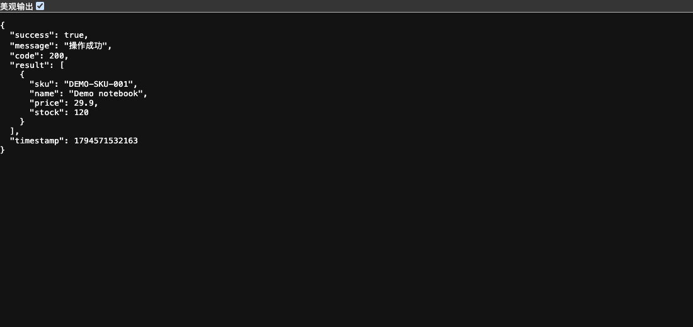
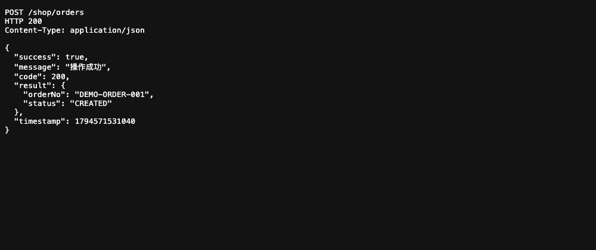

<a id="top"></a>
<div align="center">

# 🚀 Libra Spring Boot Starter Toolkit

**供 Java 开发者使用与学习 SQL 数据访问、轻量 HTTP 接口和 Redis 集成的工具集合。**

[](https://dev.java/)
[](https://spring.io/projects/spring-boot)
[](LICENSE)

[English](README_EN.md) | **简体中文**

</div>

> **本文遵循开源说明规范**：结构与徽章按统一体例，徽章仅指向公开可访问资源，版本信息指向发布渠道动态页。

---

## 📖 目录

- [快速开始](#quick-start)
- [安装与源码](#installation)
- [运行截图](#screenshots)
- [模块与边界](#modules)
- [目录结构](#structure)
- [验证与限制](#verification)
- [贡献指南](#contributing)
- [License](#license)
- [联系我们](#contact)
- [Star History](#star-history)
- [回到顶部](#back-to-top)

---

<a id="quick-start"></a>
## 🚀 快速开始

准备与模块 POM 兼容的 JDK 和 Maven；Core 的编译目标为 Java 8，依赖与精确版本以 POM 为准。以下 macOS／Linux 示例直接启动 `PostmanUtil`，不依赖 Spring Boot、MySQL 或 Redis。

在仓库根目录编译 Core 并获取依赖路径：

```sh
mvn -pl libra-toolkit-core -DskipTests compile dependency:build-classpath \
  -Dmdep.outputFile=target/readme-classpath.txt
mkdir -p target/readme-demo
```

将下面完整示例保存为 `target/LibraReadmeDemo.java`：

```java
import cn.myslayers.libra.framework.toolkit.http.PostmanUtil;
import cn.myslayers.libra.framework.toolkit.http.PostmanUtil.*;
import java.util.*;

@PostmanController("/shop")
public class LibraReadmeDemo {
    @PostmanMapping(value = "/products", method = RequestMethod.GET)
    public Result<Object> products() {
        Map<String, Object> product = new LinkedHashMap<>();
        product.put("sku", "DEMO-SKU-001");
        product.put("name", "Demo notebook");
        product.put("price", 29.90);
        product.put("stock", 120);
        return Result.ok(Collections.singletonList(product));
    }
    @PostmanMapping(value = "/orders", method = RequestMethod.POST)
    public Result<Object> orders() {
        Map<String, Object> order = new LinkedHashMap<>();
        order.put("orderNo", "DEMO-ORDER-001");
        order.put("status", "CREATED");
        return Result.ok(order);
    }
    public static void main(String[] args) throws Exception {
        int port = args.length == 0 ? 18776 : Integer.parseInt(args[0]);
        try (java.net.ServerSocket probe = new java.net.ServerSocket(port)) { }
        PostmanUtil.setPort(port);
        PostmanUtil.HttpCore.startServer(LibraReadmeDemo.class);
        Runtime.getRuntime().addShutdownHook(new Thread(PostmanUtil.HttpCore::stopServer));
        Thread.currentThread().join();
    }
}
```

编译并运行，再在另一终端请求接口：

```sh
CP="libra-toolkit-core/target/classes:$(cat libra-toolkit-core/target/readme-classpath.txt)"
javac -encoding UTF-8 -cp "$CP" -d target/readme-demo target/LibraReadmeDemo.java
java -cp "target/readme-demo:$CP" LibraReadmeDemo
```

```sh
curl http://127.0.0.1:18776/shop/products
curl -X POST http://127.0.0.1:18776/shop/orders -H 'Content-Type: application/json' -d '{}'
```
预期返回 `success: true`、`code: 200`，以及演示商品或 `DEMO-ORDER-001`。Windows 的 Java 类路径分隔符为 `;`，需改为等效 PowerShell 命令；结束时按 Ctrl+C。

选择空闲端口。工具内置启动器会尝试关闭占用端口的进程，因此示例先探测并拒绝端口冲突。该示例无鉴权，只返回内存演示数据，供本机学习，不用于公网托管或真实订单持久化。

<a id="installation"></a>
## 📦 安装与源码

源码：[GitHub](https://github.com/halavah/libra-spring-boot-starter-toolkit) · [Gitee](https://gitee.com/halavah/libra-spring-boot-starter-toolkit)，公开仓，主线 `master`。

文档：本篇、`libra-toolkit-demo/` 源码示例；补充资料位于 `libra-toolkit-docs/`。

```sh
git clone https://github.com/halavah/libra-spring-boot-starter-toolkit.git
cd libra-spring-boot-starter-toolkit
mvn -pl libra-toolkit-core -DskipTests install
```

源码构建将 `cn.myslayers:libra-toolkit-core` 安装到本机 Maven 仓库；版本从 [模块 POM](libra-toolkit-core/pom.xml) 或 [Releases](https://github.com/halavah/libra-spring-boot-starter-toolkit/releases) 选择，不假设 Maven Central 已发布，也不写死附件名。`start.sh`、`start.ps1` 是发布启动器，不是开发服务启动命令。

<a id="screenshots"></a>
## 🖼️ 运行截图

商品响应来自上方完整示例启动的真实 `PostmanUtil` 接口；订单截图呈现同一示例实际 POST 请求的响应。数据均为虚构，不涉及外部数据库。





<a id="modules"></a>
## 🧩 模块与边界

| 能力 | 入口 | 边界 |
|---|---|---|
| SQL／数据访问 | `database/DatabaseUtil*.java` | 自行配置数据源；不同变体的初始化与配置方式不同 |
| 轻量 HTTP | `http/PostmanUtil.java` | 注解控制器、注册／扫描、路由、请求上下文及 JSON 响应 |
| Redis | `redis/RedissonUtil.java` | 需要自己的 Redis 及客户端配置 |
| 许可辅助 | `license/` | 许可证生成与校验辅助，不代表应用整体安全已验收 |

使用前阅读具体类的 API，不把多个变体当作完全相同的实现。快速示例只验证 HTTP 注册与响应，不代表 SQL 事务、Redis 锁或性能指标已验证。

<a id="structure"></a>
## 🗂️ 目录结构

```text
pom.xml                # Aggregator
libra-toolkit-core/    # Database, HTTP, Redis and license utilities
libra-toolkit-demo/    # Spring Boot examples, configuration and tests
libra-toolkit-docs/    # Additional material
assets/screenshots/   # README screenshots
start.sh / start.ps1   # Release launchers
```

<a id="verification"></a>
## ✅ 验证与限制

本地已编译 Core、使用 Java 8 编译完整示例，并请求商品 GET 与订单 POST 接口；截图服务运行相同示例，不依赖外部持久化。

未运行 Redis 集成测试、数据库集成套件、完整 Spring Boot Demo 或性能压力测试。Demo 的开发 H2 配置与测试作用域驱动，不意味着打包后的 Spring Boot 应用自动具备完整自包含环境；启动前核对配置及依赖作用域。本篇以独立 HTTP 示例作为可复现的最小运行路径。

<a id="contributing"></a>
## 🤝 贡献指南

获授权协作者从 `master` 创建功能分支，完成验证后提交 PR；公开仓也可先 Fork。保持提交范围明确，写清实际执行的命令及未运行检查。

保持 Java 兼容基线与公开 API，明确显式注册和扫描机制的改动。数据库与 Redis 集成验证使用隔离实例；逐项报告未运行检查，不在共享服务上执行清理或破坏性测试。

<a id="license"></a>
## 📄 License

[GNU AGPL-3.0](LICENSE)。

- ✅ 按协议允许使用、研究、修改及商业使用。
- ⚠️ 分发及修改版本需履行对应源码和声明义务；用户通过网络与修改版本交互时，应履行适用的 AGPL 源码提供要求。
- 不提供担保；集成、分发或提供服务前，应阅读完整协议。

选择 AGPL，是为了让共享改进继续对使用者开放，包括适用的网络服务场景。

<a id="contact"></a>
## 📮 联系我们

维护者：[halavah](https://github.com/halavah)。

- [问题反馈](https://github.com/halavah/libra-spring-boot-starter-toolkit/issues)
- [发布渠道](https://github.com/halavah/libra-spring-boot-starter-toolkit/releases)：可通过 Watch → Custom → Releases 订阅发布。

<a id="star-history"></a>
## ⭐ Star History

如果项目对您有帮助，欢迎 Star 支持。

[](https://star-history.com/#halavah/libra-spring-boot-starter-toolkit&Date)

<a id="back-to-top"></a>
## ⬆ 回到顶部

用 ❤️ 构建 | Made with ❤️

如果这个项目对您有帮助，欢迎给予 Star 支持。

[⬆ 回到顶部](#top)
