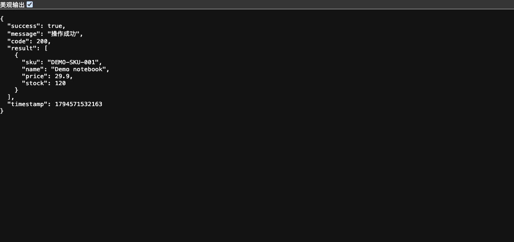
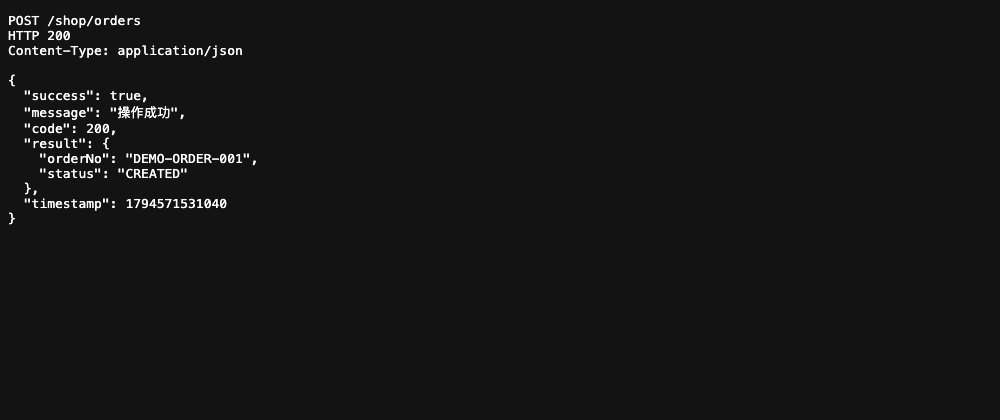

<a id="top"></a>
<div align="center">

# 🚀 Libra Spring Boot Starter Toolkit

**Java utilities for exploring SQL access, lightweight HTTP endpoints and Redis integration.**

[](https://dev.java/)
[](https://spring.io/projects/spring-boot)
[](LICENSE)

**English** | [简体中文](README.md)

</div>

> This README follows the open-source documentation standard: consistent structure and badges, public badge resources only, and release-channel pages for current versions.

---

## 📖 Contents

- [Quick start](#quick-start)
- [Installation and source](#installation)
- [Running screenshots](#screenshots)
- [Modules and boundaries](#modules)
- [Structure](#structure)
- [Verification and limitations](#verification)
- [Contributing](#contributing)
- [License](#license)
- [Contact](#contact)
- [Star History](#star-history)
- [Back to top](#back-to-top)

---

<a id="quick-start"></a>
## 🚀 Quick start

Use a JDK and Maven compatible with the module POM. The core targets Java 8; dependencies and exact versions are defined in the POM. The following macOS/Linux example starts `PostmanUtil` without Spring Boot, MySQL or Redis.

From the repository root, compile the core and obtain its classpath:

```sh
mvn -pl libra-toolkit-core -DskipTests compile dependency:build-classpath \
  -Dmdep.outputFile=target/readme-classpath.txt
mkdir -p target/readme-demo
```

Save the following complete example as `target/LibraReadmeDemo.java`:

```java
import cn.myslayers.libra.framework.toolkit.http.PostmanUtil;
import cn.myslayers.libra.framework.toolkit.http.PostmanUtil.*;
import java.util.*;

@PostmanController("/shop")
public class LibraReadmeDemo {
    @PostmanMapping(value = "/products", method = RequestMethod.GET)
    public Result<Object> products() {
        Map<String, Object> product = new LinkedHashMap<>();
        product.put("sku", "DEMO-SKU-001");
        product.put("name", "Demo notebook");
        product.put("price", 29.90);
        product.put("stock", 120);
        return Result.ok(Collections.singletonList(product));
    }
    @PostmanMapping(value = "/orders", method = RequestMethod.POST)
    public Result<Object> orders() {
        Map<String, Object> order = new LinkedHashMap<>();
        order.put("orderNo", "DEMO-ORDER-001");
        order.put("status", "CREATED");
        return Result.ok(order);
    }
    public static void main(String[] args) throws Exception {
        int port = args.length == 0 ? 18776 : Integer.parseInt(args[0]);
        try (java.net.ServerSocket probe = new java.net.ServerSocket(port)) { }
        PostmanUtil.setPort(port);
        PostmanUtil.HttpCore.startServer(LibraReadmeDemo.class);
        Runtime.getRuntime().addShutdownHook(new Thread(PostmanUtil.HttpCore::stopServer));
        Thread.currentThread().join();
    }
}
```

Compile and run, then request it from another terminal:

```sh
CP="libra-toolkit-core/target/classes:$(cat libra-toolkit-core/target/readme-classpath.txt)"
javac -encoding UTF-8 -cp "$CP" -d target/readme-demo target/LibraReadmeDemo.java
java -cp "target/readme-demo:$CP" LibraReadmeDemo
```

```sh
curl http://127.0.0.1:18776/shop/products
curl -X POST http://127.0.0.1:18776/shop/orders -H 'Content-Type: application/json' -d '{}'
```
Expected: JSON with `success: true`, `code: 200`, a demonstration product or `DEMO-ORDER-001`. Windows uses `;` rather than `:` in Java classpaths and requires equivalent PowerShell commands. Stop the example with Ctrl+C.

Use an unused port. The sample probes the port before calling the toolkit because the built-in launcher attempts to close an existing port owner. The demo has no authentication and uses a tiny in-memory response; it is for local exploration, not public hosting or durable order processing.

<a id="installation"></a>
## 📦 Installation and source

Source code: [GitHub](https://github.com/halavah/libra-spring-boot-starter-toolkit) · [Gitee](https://gitee.com/halavah/libra-spring-boot-starter-toolkit), public, branch `master`.

Documentation: this README and source examples under `libra-toolkit-demo/`; additional materials live in `libra-toolkit-docs/`.

```sh
git clone https://github.com/halavah/libra-spring-boot-starter-toolkit.git
cd libra-spring-boot-starter-toolkit
mvn -pl libra-toolkit-core -DskipTests install
```

Source builds install `cn.myslayers:libra-toolkit-core` into your local Maven repository. Select the version from [the module POM](libra-toolkit-core/pom.xml) or [Releases](https://github.com/halavah/libra-spring-boot-starter-toolkit/releases); this README does not assume Maven Central availability or pin an artifact filename. `start.sh` and `start.ps1` are publishing launchers, not development-server commands.

<a id="screenshots"></a>
## 🖼️ Running screenshots

The product response was captured from a real `PostmanUtil` endpoint using the complete example above. The order image displays the actual POST response captured from the same demo. Values are synthetic; no external database is involved.





<a id="modules"></a>
## 🧩 Modules and boundaries

| Area | Entry | Boundary |
|---|---|---|
| SQL/data access | `database/DatabaseUtil*.java` | Supply appropriate data sources; variants have different initialization/configuration behavior |
| Lightweight HTTP | `http/PostmanUtil.java` | Annotated controllers, registration/scanning, routing, request context and JSON responses |
| Redis | `redis/RedissonUtil.java` | Requires your own Redis and client configuration |
| License helpers | `license/` | License generation/validation helpers; not proof of application-wide security |

Read the concrete class API before using a variant. The quick start validates HTTP registration and responses only; it does not validate SQL transactions, Redis locks or performance claims.

<a id="structure"></a>
## 🗂️ Structure

```text
pom.xml                # Aggregator
libra-toolkit-core/    # Database, HTTP, Redis and license utilities
libra-toolkit-demo/    # Spring Boot examples, configuration and tests
libra-toolkit-docs/    # Additional material
assets/screenshots/   # README screenshots
start.sh / start.ps1   # Release launchers
```

<a id="verification"></a>
## ✅ Verification and limitations

Local checks compiled the Core module, compiled the complete example with Java 8, and exercised product GET and order POST endpoints. The screenshot service used the same example without external persistence.

Redis integration tests, database integration suites, the full Spring Boot demo and performance/load testing were not run. The demo’s development H2 configuration and its test-scoped driver do not automatically make the packaged Spring Boot application self-contained. Review configuration and dependency scopes before launching it. The standalone HTTP example is the reproducible minimal path documented here.

<a id="contributing"></a>
## 🤝 Contributing

Authorized collaborators create a feature branch from `master`, validate their changes and submit a PR. Public repositories may be forked first. Keep changes focused and state the commands run and any checks omitted.

Preserve the Java compatibility baseline and public API. Document any change to explicit registration or scanning. Use isolated databases and Redis instances for integration tests; report checks not run. Never exercise destructive database or Redis tests against shared services.

<a id="license"></a>
## 📄 License

[GNU AGPL-3.0](LICENSE).

- ✅ Allows use, study, modification and commercial use under its terms.
- ⚠️ Redistribution and modified versions carry corresponding-source and notice obligations. If users interact remotely with a modified version over a network, the applicable AGPL source-offer requirement must be met.
- No warranty is provided. Consult the full license when integrating or distributing the toolkit.

AGPL keeps shared improvements available to users, including relevant network-service use.

<a id="contact"></a>
## 📮 Contact

Maintainer: [halavah](https://github.com/halavah).

- [Issues](https://github.com/halavah/libra-spring-boot-starter-toolkit/issues)
- [Releases](https://github.com/halavah/libra-spring-boot-starter-toolkit/releases) — use Watch → Custom → Releases to follow releases.

<a id="star-history"></a>
## ⭐ Star History

If this project is useful, consider starring it.

[](https://star-history.com/#halavah/libra-spring-boot-starter-toolkit&Date)

<a id="back-to-top"></a>
## ⬆ Back to top

Made with ❤️. If this project helps you, consider giving it a Star.

[⬆ Back to top](#top)
