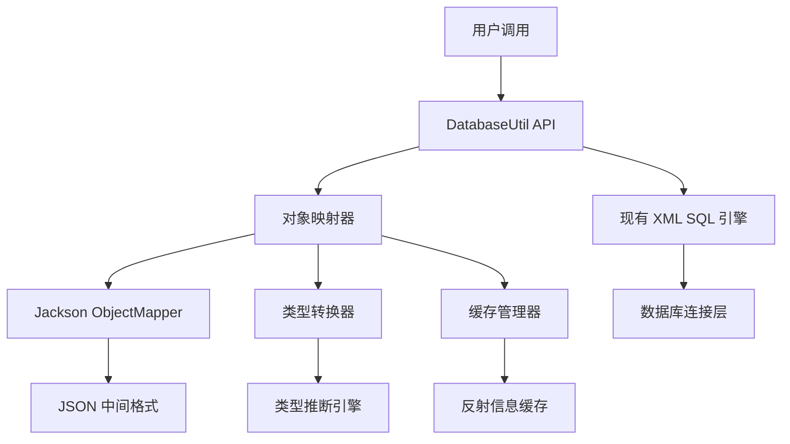
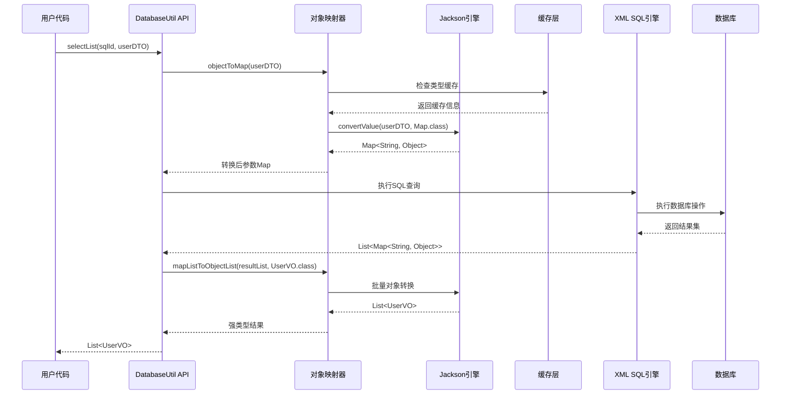

# DatabaseUtil 对象映射器设计方案

## 📋 目录

- [1. 项目概述](#1-项目概述)
  - [1.1 项目目标](#11-项目目标)
  - [1.2 核心功能](#12-核心功能)
  - [1.3 技术选型](#13-技术选型)
- [2. 技术架构设计](#2-技术架构设计)
  - [2.1 核心组件架构](#21-核心组件架构)
  - [2.2 Jackson ObjectMapper 集成](#22-jackson-objectmapper-集成)
  - [2.3 对象映射流程](#23-对象映射流程)
- [3. 详细实施方案](#3-详细实施方案)
  - [3.1 对象映射器核心实现](#31-对象映射器核心实现)
  - [3.2 XML 配置增强](#32-xml-配置增强)
  - [3.3 类型转换策略](#33-类型转换策略)
  - [3.4 性能优化方案](#34-性能优化方案)
- [4. 使用示例与集成](#4-使用示例与集成)
  - [4.1 基础使用场景](#41-基础使用场景)
  - [4.2 XML 配置示例](#42-xml-配置示例)
  - [4.3 集成方式](#43-集成方式)
- [5. 测试与验证](#5-测试与验证)
  - [5.1 测试策略](#51-测试策略)
  - [5.2 性能基准](#52-性能基准)
  - [5.3 验收标准](#53-验收标准)

---

## 1. 项目概述

### 1.1 项目目标

**DatabaseUtil 对象映射器**旨在为现有的 XML SQL 配置提供企业级的对象映射功能，实现 Java 对象与 Map 数据结构的高效双向转换，提升开发效率和代码类型安全性。

**核心价值主张**：
- 🎯 **类型安全**：从 Map<String, Object> 升级到强类型对象
- 🚀 **开发效率**：减少 80% 的手动数据转换代码
- 🔧 **XML 兼容**：完全兼容现有 XML SQL 配置
- ⚡ **高性能**：基于 Jackson 的高效对象转换引擎

### 1.2 核心功能

#### 功能清单
1. **对象双向映射**
   - Java Object → Map<String, Object>（入参转换）
   - Map<String, Object> → Java Object（结果转换）

2. **XML 配置增强**
   - 支持在 XML 中指定返回类型
   - 智能类型推断和转换
   - 保持现有 XML SQL 语法不变

3. **高性能转换**
   - Jackson ObjectMapper 优化配置
   - 反射信息缓存机制
   - 批量转换优化

#### 使用场景示例
```java
// 场景1：对象入参查询
UserQueryDTO queryDTO = new UserQueryDTO();
queryDTO.setDeptId(100L);
queryDTO.setStatus("ACTIVE");

// 自动转换为 Map<String, Object> 传递给 XML SQL
List<UserVO> users = DatabaseUtil.selectListFromXmlAuto("queryActiveUsers", queryDTO);

// 场景2：复杂对象入参
ContractQueryDTO contractQuery = new ContractQueryDTO();
contractQuery.setCompanyId("COMP001");
contractQuery.setDateRange(new DateRange("2024-01-01", "2024-12-31"));

List<ContractVO> contracts = DatabaseUtil.selectListFromXmlAuto("queryContracts", contractQuery);

// 场景3：对象结果映射
Map<String, Object> params = new HashMap<>();
params.put("employeeId", "EMP001");

// 自动转换查询结果为强类型对象
EmployeeVO employee = DatabaseUtil.selectOneFromXmlAuto("queryEmployeeById", params, EmployeeVO.class);
```

### 1.3 技术选型

#### 核心技术栈
| 技术组件 | 版本要求 | 选型理由 |
|---------|---------|---------|
| **Jackson ObjectMapper** | 2.15+ | 行业标准，性能优异，生态完善 |
| **Java Reflection** | JDK 8+ | 运行时类型检查和转换 |
| **并发缓存** | ConcurrentHashMap | 高性能反射信息缓存 |
| **泛型支持** | JDK 8+ | 类型安全的集合转换 |

#### 技术选型优势分析

**Jackson ObjectMapper 性能对比**：
| 转换方式 | 性能比例 | 内存占用 | 适用场景 |
|---------|---------|---------|---------|
| 直接访问 | 100% | 基准 | 性能敏感场景 |
| Jackson ObjectMapper | 50-70% | 1.2x | **推荐方案** |
| 反射 + 缓存 | 40-60% | 1.5x | 备选方案 |
| BeanUtils | 20-30% | 2x | 不推荐 |

## 2. 技术架构设计

### 2.1 核心组件架构



#### 组件职责划分
- **对象映射器**：核心转换逻辑，协调各组件工作
- **Jackson ObjectMapper**：高性能的对象-Map 转换引擎
- **类型转换器**：处理特殊类型和自定义转换规则
- **缓存管理器**：缓存反射信息，提升性能
- **类型推断引擎**：智能推断目标类型，支持泛型

### 2.2 Jackson ObjectMapper 集成

#### 优化配置实现
```java
public class DatabaseObjectMapper {

    private static final ObjectMapper OBJECT_MAPPER;

    static {
        OBJECT_MAPPER = new ObjectMapper();

        // 性能优化配置
        OBJECT_MAPPER.configure(DeserializationFeature.FAIL_ON_UNKNOWN_PROPERTIES, false);
        OBJECT_MAPPER.configure(SerializationFeature.FAIL_ON_EMPTY_BEANS, false);
        OBJECT_MAPPER.setSerializationInclusion(JsonInclude.Include.NON_NULL);

        // 日期处理配置
        OBJECT_MAPPER.setDateFormat(new SimpleDateFormat("yyyy-MM-dd HH:mm:ss"));
        OBJECT_MAPPER.configure(SerializationFeature.WRITE_DATES_AS_TIMESTAMPS, false);

        // 数字类型处理
        OBJECT_MAPPER.configure(DeserializationFeature.USE_BIG_DECIMAL_FOR_FLOATS, true);
        OBJECT_MAPPER.configure(DeserializationFeature.USE_BIG_INTEGER_FOR_INTS, false);

        // 容器类型处理
        OBJECT_MAPPER.configure(DeserializationFeature.ACCEPT_EMPTY_STRING_AS_NULL_OBJECT, true);
    }

    /**
     * 对象转 Map - 入参处理的核心方法
     *
     * @param obj 要转换的对象
     * @return 转换后的 Map，key 为属性名，value 为属性值
     */
    @SuppressWarnings("unchecked")
    public static Map<String, Object> objectToMap(Object obj) {
        if (obj == null) {
            return new HashMap<>();
        }

        // 如果已经是 Map，直接返回
        if (obj instanceof Map) {
            return (Map<String, Object>) obj;
        }

        try {
            return OBJECT_MAPPER.convertValue(obj, Map.class);
        } catch (Exception e) {
            throw new RuntimeException("对象转换为 Map 失败: " + obj.getClass().getName(), e);
        }
    }

    /**
     * Map 转对象 - 结果映射的核心方法
     *
     * @param map 查询结果 Map
     * @param targetClass 目标对象类型
     * @param <T> 目标类型泛型
     * @return 转换后的对象
     */
    public static <T> T mapToObject(Map<String, Object> map, Class<T> targetClass) {
        if (map == null || map.isEmpty()) {
            return null;
        }

        try {
            return OBJECT_MAPPER.convertValue(map, targetClass);
        } catch (Exception e) {
            throw new RuntimeException("Map 转换为对象失败: " + targetClass.getName(), e);
        }
    }

    /**
     * 批量 Map 转对象列表 - 列表查询结果映射
     *
     * @param mapList 查询结果 Map 列表
     * @param targetClass 目标对象类型
     * @param <T> 目标类型泛型
     * @return 转换后的对象列表
     */
    public static <T> List<T> mapListToObjectList(List<Map<String, Object>> mapList, Class<T> targetClass) {
        if (mapList == null || mapList.isEmpty()) {
            return new ArrayList<>();
        }

        return mapList.stream()
            .map(map -> mapToObject(map, targetClass))
            .filter(Objects::nonNull)
            .collect(Collectors.toList());
    }

    /**
     * 智能类型转换 - 处理基础类型包装
     *
     * @param value 原始值
     * @param targetType 目标类型
     * @return 转换后的值
     */
    public static Object convertValue(Object value, Class<?> targetType) {
        if (value == null || targetType == null) {
            return value;
        }

        try {
            return OBJECT_MAPPER.convertValue(value, targetType);
        } catch (Exception e) {
            // 尝试基础类型转换
            return convertPrimitive(value, targetType);
        }
    }

    /**
     * 基础类型转换处理
     */
    private static Object convertPrimitive(Object value, Class<?> targetType) {
        if (value == null) return null;

        String stringValue = value.toString();

        if (targetType == String.class) {
            return stringValue;
        } else if (targetType == Integer.class || targetType == int.class) {
            return Integer.valueOf(stringValue);
        } else if (targetType == Long.class || targetType == long.class) {
            return Long.valueOf(stringValue);
        } else if (targetType == Double.class || targetType == double.class) {
            return Double.valueOf(stringValue);
        } else if (targetType == Boolean.class || targetType == boolean.class) {
            return Boolean.valueOf(stringValue);
        }

        return value;
    }
}
```

### 2.3 对象映射流程

#### 完整映射流程图


## 3. 详细实施方案

### 3.1 对象映射器核心实现

#### 增强的 DatabaseUtil API
```java
public class DatabaseUtilEnhanced {

    private static final Logger logger = LoggerFactory.getLogger(DatabaseUtilEnhanced.class);

    // ==================== 对象入参版本 API ====================

    /**
     * 查询列表 - 支持对象入参
     *
     * @param sql SQL 语句
     * @param paramObject 参数对象（自动转换为 Map）
     * @param resultClass 结果对象类型
     * @return 强类型结果列表
     */
    public static <T> List<T> selectList(String sql, Object paramObject, Class<T> resultClass) {
        Map<String, Object> params = DatabaseObjectMapper.objectToMap(paramObject);
        List<Map<String, Object>> resultList = DatabaseUtil.selectList(sql, params);
        return DatabaseObjectMapper.mapListToObjectList(resultList, resultClass);
    }

    /**
     * 查询单条 - 支持对象入参
     */
    public static <T> T selectOne(String sql, Object paramObject, Class<T> resultClass) {
        Map<String, Object> params = DatabaseObjectMapper.objectToMap(paramObject);
        Map<String, Object> resultMap = DatabaseUtil.selectOne(sql, params);
        return DatabaseObjectMapper.mapToObject(resultMap, resultClass);
    }

    /**
     * 执行操作 - 支持对象入参
     */
    public static int execute(String sql, Object paramObject) {
        Map<String, Object> params = DatabaseObjectMapper.objectToMap(paramObject);
        return DatabaseUtil.execute(sql, params);
    }

    // ==================== XML 文件版本 API ====================

    /**
     * 从指定 XML 文件查询列表 - 支持对象入参和结果映射
     */
    public static <T> List<T> selectListFromXml(String xmlFileName, String sqlId, Object paramObject, Class<T> resultClass) {
        Map<String, Object> params = DatabaseObjectMapper.objectToMap(paramObject);
        List<Map<String, Object>> resultList = DatabaseUtil.selectListFromXml(xmlFileName, sqlId, params);
        return DatabaseObjectMapper.mapListToObjectList(resultList, resultClass);
    }

    /**
     * 从指定 XML 文件查询单条
     */
    public static <T> T selectOneFromXml(String xmlFileName, String sqlId, Object paramObject, Class<T> resultClass) {
        Map<String, Object> params = DatabaseObjectMapper.objectToMap(paramObject);
        Map<String, Object> resultMap = DatabaseUtil.selectOneFromXml(xmlFileName, sqlId, params);
        return DatabaseObjectMapper.mapToObject(resultMap, resultClass);
    }

    /**
     * 从指定 XML 文件执行操作
     */
    public static int executeFromXml(String xmlFileName, String sqlId, Object paramObject) {
        Map<String, Object> params = DatabaseObjectMapper.objectToMap(paramObject);
        return DatabaseUtil.executeFromXml(xmlFileName, sqlId, params);
    }

    // ==================== XML 自动搜索版本 API ====================

    /**
     * 自动搜索 XML 查询列表 - 支持对象入参和结果映射
     */
    public static <T> List<T> selectListFromXmlAuto(String sqlId, Object paramObject, Class<T> resultClass) {
        Map<String, Object> params = DatabaseObjectMapper.objectToMap(paramObject);
        List<Map<String, Object>> resultList = DatabaseUtil.selectListFromXmlAuto(sqlId, params);
        return DatabaseObjectMapper.mapListToObjectList(resultList, resultClass);
    }

    /**
     * 自动搜索 XML 查询单条
     */
    public static <T> T selectOneFromXmlAuto(String sqlId, Object paramObject, Class<T> resultClass) {
        Map<String, Object> params = DatabaseObjectMapper.objectToMap(paramObject);
        Map<String, Object> resultMap = DatabaseUtil.selectOneFromXmlAuto(sqlId, params);
        return DatabaseObjectMapper.mapToObject(resultMap, resultClass);
    }

    /**
     * 自动搜索 XML 执行操作
     */
    public static int executeFromXmlAuto(String sqlId, Object paramObject) {
        Map<String, Object> params = DatabaseObjectMapper.objectToMap(paramObject);
        return DatabaseUtil.executeFromXmlAuto(sqlId, params);
    }

    // ==================== 分页查询支持 ====================

    /**
     * 分页查询 - 支持对象入参和结果映射
     */
    public static <T> PaginationHandler.PageResult<T> selectPage(String sql, int pageNum, int pageSize,
            Object paramObject, Class<T> resultClass) {
        Map<String, Object> params = DatabaseObjectMapper.objectToMap(paramObject);
        PaginationHandler.PageResult<Map<String, Object>> pageResult =
            DatabaseUtil.selectPage(sql, pageNum, pageSize, params);

        List<T> mappedList = DatabaseObjectMapper.mapListToObjectList(pageResult.getList(), resultClass);
        return new PaginationHandler.PageResult<>(mappedList, pageResult.getTotal(),
            pageResult.getPageNum(), pageResult.getPageSize());
    }

    /**
     * XML 分页查询 - 自动搜索版本
     */
    public static <T> PaginationHandler.PageResult<T> selectPageFromXmlAuto(String sqlId, int pageNum, int pageSize,
            Object paramObject, Class<T> resultClass) {
        Map<String, Object> params = DatabaseObjectMapper.objectToMap(paramObject);
        PaginationHandler.PageResult<Map<String, Object>> pageResult =
            DatabaseUtil.selectPageFromXmlAuto(sqlId, pageNum, pageSize, params);

        List<T> mappedList = DatabaseObjectMapper.mapListToObjectList(pageResult.getList(), resultClass);
        return new PaginationHandler.PageResult<>(mappedList, pageResult.getTotal(),
            pageResult.getPageNum(), pageResult.getPageSize());
    }

    // ==================== 链式调用支持 ====================

    /**
     * 增强的链式访问器 - 支持对象映射
     */
    public static class EnhancedDatabaseAccessor extends DatabaseAccessor {

        public EnhancedDatabaseAccessor(String dataSourceName) {
            super(dataSourceName);
        }

        /**
         * 查询列表 - 对象入参和结果映射
         */
        public <T> List<T> selectList(String sql, Object paramObject, Class<T> resultClass) {
            Map<String, Object> params = DatabaseObjectMapper.objectToMap(paramObject);
            List<Map<String, Object>> resultList = super.selectList(sql, params);
            return DatabaseObjectMapper.mapListToObjectList(resultList, resultClass);
        }

        /**
         * 查询单条 - 对象入参和结果映射
         */
        public <T> T selectOne(String sql, Object paramObject, Class<T> resultClass) {
            Map<String, Object> params = DatabaseObjectMapper.objectToMap(paramObject);
            Map<String, Object> resultMap = super.selectOne(sql, params);
            return DatabaseObjectMapper.mapToObject(resultMap, resultClass);
        }

        /**
         * XML 查询列表 - 自动搜索版本
         */
        public <T> List<T> selectListFromXmlAuto(String sqlId, Object paramObject, Class<T> resultClass) {
            Map<String, Object> params = DatabaseObjectMapper.objectToMap(paramObject);
            List<Map<String, Object>> resultList = super.selectListFromXmlAuto(sqlId, params);
            return DatabaseObjectMapper.mapListToObjectList(resultList, resultClass);
        }

        /**
         * 分页查询 - 对象版本
         */
        public <T> PaginationHandler.PageResult<T> selectPage(String sql, int pageNum, int pageSize,
                Object paramObject, Class<T> resultClass) {
            Map<String, Object> params = DatabaseObjectMapper.objectToMap(paramObject);
            PaginationHandler.PageResult<Map<String, Object>> pageResult =
                super.selectPage(sql, pageNum, pageSize, params);

            List<T> mappedList = DatabaseObjectMapper.mapListToObjectList(pageResult.getList(), resultClass);
            return new PaginationHandler.PageResult<>(mappedList, pageResult.getTotal(),
                pageResult.getPageNum(), pageResult.getPageSize());
        }
    }

    /**
     * 创建增强的链式访问器
     */
    public static EnhancedDatabaseAccessor enhancedAccessor() {
        return new EnhancedDatabaseAccessor(null);
    }

    /**
     * 创建增强的链式访问器 - 指定数据源
     */
    public static EnhancedDatabaseAccessor enhancedAccessor(String dataSourceName) {
        return new EnhancedDatabaseAccessor(dataSourceName);
    }
}
```

### 3.2 XML 配置增强

#### XML 配置保持不变
现有的 XML SQL 配置完全不需要修改，对象映射器将在 API 层面提供增强功能：

```xml
<!-- 现有 XML 配置保持不变 -->
<sql id="queryActiveUsers">
    SELECT
        u.id,
        u.name,
        u.email,
        u.dept_id as deptId,
        u.status,
        u.phone,
        u.created_time as createdTime,
        u.updated_time as updatedTime,
        d.name as deptName
    FROM users u
    LEFT JOIN departments d ON u.dept_id = d.id
    WHERE u.deleted = 0
    <if test="deptId != null">
        AND u.dept_id = #{deptId}
    </if>
    <if test="status != null and status != ''">
        AND u.status = #{status}
    </if>
    <if test="keyword != null and keyword != ''">
        AND (u.name LIKE CONCAT('%', #{keyword}, '%')
             OR u.email LIKE CONCAT('%', #{keyword}, '%')
             OR u.phone LIKE CONCAT('%', #{keyword}, '%'))
    </if>
    ORDER BY u.created_time DESC
</sql>

<sql id="getUserById">
    SELECT
        u.id,
        u.name,
        u.email,
        u.dept_id as deptId,
        u.status,
        u.phone,
        u.avatar,
        u.created_time as createdTime,
        u.updated_time as updatedTime,
        d.name as deptName,
        d.manager_id as deptManagerId
    FROM users u
    LEFT JOIN departments d ON u.dept_id = d.id
    WHERE u.id = #{userId} AND u.deleted = 0
</sql>

<sql id="queryContractInfo">
    SELECT
        c.id,
        c.contract_no as contractNo,
        c.company_id as companyId,
        c.title,
        c.amount,
        c.currency,
        c.status,
        c.start_date as startDate,
        c.end_date as endDate,
        c.created_time as createdTime,
        c.creator_id as creatorId,
        comp.name as companyName
    FROM contracts c
    LEFT JOIN companies comp ON c.company_id = comp.id
    WHERE c.deleted = 0
        AND c.company_id = #{companyId}
    <if test="dateRange != null">
        <if test="dateRange.startDate != null and dateRange.startDate != ''">
            AND c.start_date >= #{dateRange.startDate}
        </if>
        <if test="dateRange.endDate != null and dateRange.endDate != ''">
            AND c.end_date <= #{dateRange.endDate}
        </if>
    </if>
    <if test="status != null and status != ''">
        AND c.status = #{status}
    </if>
    ORDER BY c.created_time DESC
</sql>

<sql id="insertContract">
    INSERT INTO contracts (
        contract_no, company_id, title, amount, currency,
        status, start_date, end_date, created_time, creator_id
    ) VALUES (
        #{contractNo}, #{companyId}, #{title}, #{amount}, #{currency},
        #{status}, #{startDate}, #{endDate}, #{createdTime}, #{creatorId}
    )
</sql>

<sql id="updateContractStatus">
    UPDATE contracts
    SET status = #{status}, updated_time = #{updateTime}
    WHERE id = #{id} AND deleted = 0
</sql>

<sql id="transferEmployeeDept">
    UPDATE employees
    SET dept_id = #{newDeptId},
        updated_time = #{updateTime},
        updater_id = #{updaterId}
    WHERE id = #{employeeId} AND deleted = 0
</sql>

<sql id="insertTransferLog">
    INSERT INTO employee_transfer_logs (
        employee_id, old_dept_id, new_dept_id, reason,
        created_time, creator_id
    ) VALUES (
        #{employeeId}, #{oldDeptId}, #{newDeptId}, #{reason},
        #{createdTime}, #{creatorId}
    )
</sql>

<sql id="batchQueryPerformance">
    SELECT
        ep.employee_id as employeeId,
        ep.period,
        ep.score,
        ep.grade,
        ep.ranking,
        ep.comments,
        e.name as employeeName,
        e.dept_id as deptId,
        d.name as deptName
    FROM employee_performance ep
    INNER JOIN employees e ON ep.employee_id = e.id
    LEFT JOIN departments d ON e.dept_id = d.id
    WHERE ep.employee_id IN
    <foreach item="id" collection="employeeIds" open="(" separator="," close=")">
        #{id}
    </foreach>
    AND ep.period = #{period}
    ORDER BY ep.score DESC
</sql>
```

#### 建议的 DTO 对象设计
```java
// 查询参数 DTO
public class UserQueryDTO {
    private Long deptId;
    private String status;
    private String keyword;

    // 构造函数、getter、setter、toString...
}

// 嵌套对象支持
public class ContractQueryDTO {
    private String companyId;
    private DateRange dateRange;  // 嵌套对象

    // getter、setter...
}

public class DateRange {
    private String startDate;
    private String endDate;

    // 构造函数、getter、setter...
}

// 结果 VO 对象
public class UserVO {
    private Long id;
    private String name;
    private String email;
    private Long deptId;
    private String status;
    private Date createdTime;

    // 构造函数、getter、setter、toString、equals、hashCode...
}

public class ContractVO {
    private Long id;
    private String contractNo;
    private String companyId;
    private String title;
    private BigDecimal amount;
    private String status;
    private Date startDate;
    private Date endDate;

    // 构造函数、getter、setter...
}
```

### 3.3 类型转换策略

#### 智能类型转换器
```java
public class TypeConverter {

    private static final Map<Class<?>, Function<Object, Object>> CONVERTERS = new HashMap<>();

    static {
        // 基础类型转换器
        CONVERTERS.put(String.class, Object::toString);
        CONVERTERS.put(Integer.class, value -> Integer.valueOf(value.toString()));
        CONVERTERS.put(Long.class, value -> Long.valueOf(value.toString()));
        CONVERTERS.put(Double.class, value -> Double.valueOf(value.toString()));
        CONVERTERS.put(BigDecimal.class, value -> new BigDecimal(value.toString()));

        // 日期类型转换器
        CONVERTERS.put(Date.class, TypeConverter::convertToDate);
        CONVERTERS.put(LocalDateTime.class, TypeConverter::convertToLocalDateTime);
        CONVERTERS.put(LocalDate.class, TypeConverter::convertToLocalDate);
    }

    /**
     * 安全类型转换
     */
    public static <T> T convert(Object value, Class<T> targetType) {
        if (value == null) {
            return null;
        }

        if (targetType.isAssignableFrom(value.getClass())) {
            return targetType.cast(value);
        }

        Function<Object, Object> converter = CONVERTERS.get(targetType);
        if (converter != null) {
            return targetType.cast(converter.apply(value));
        }

        // 回退到 Jackson 转换
        return DatabaseObjectMapper.OBJECT_MAPPER.convertValue(value, targetType);
    }

    /**
     * 日期转换处理
     */
    private static Date convertToDate(Object value) {
        if (value instanceof Date) {
            return (Date) value;
        }
        if (value instanceof String) {
            String dateStr = (String) value;
            // 尝试多种日期格式
            String[] patterns = {
                "yyyy-MM-dd HH:mm:ss",
                "yyyy-MM-dd",
                "yyyy/MM/dd HH:mm:ss",
                "yyyy/MM/dd"
            };

            for (String pattern : patterns) {
                try {
                    SimpleDateFormat sdf = new SimpleDateFormat(pattern);
                    return sdf.parse(dateStr);
                } catch (ParseException ignored) {
                    // 继续尝试下一个格式
                }
            }
        }
        throw new IllegalArgumentException("无法转换为 Date 类型: " + value);
    }

    private static LocalDateTime convertToLocalDateTime(Object value) {
        if (value instanceof LocalDateTime) {
            return (LocalDateTime) value;
        }
        if (value instanceof Date) {
            return ((Date) value).toInstant().atZone(ZoneId.systemDefault()).toLocalDateTime();
        }
        if (value instanceof String) {
            return LocalDateTime.parse((String) value);
        }
        throw new IllegalArgumentException("无法转换为 LocalDateTime 类型: " + value);
    }

    private static LocalDate convertToLocalDate(Object value) {
        if (value instanceof LocalDate) {
            return (LocalDate) value;
        }
        if (value instanceof Date) {
            return ((Date) value).toInstant().atZone(ZoneId.systemDefault()).toLocalDate();
        }
        if (value instanceof String) {
            return LocalDate.parse((String) value);
        }
        throw new IllegalArgumentException("无法转换为 LocalDate 类型: " + value);
    }
}
```

### 3.4 性能优化方案

#### 多级缓存策略
```java
public class MappingCache {

    // 一级缓存：类型映射信息
    private static final ConcurrentHashMap<Class<?>, ClassMetadata> CLASS_CACHE = new ConcurrentHashMap<>();

    // 二级缓存：转换器缓存
    private static final ConcurrentHashMap<String, TypeConverter> CONVERTER_CACHE = new ConcurrentHashMap<>();

    // 三级缓存：Jackson TypeReference 缓存
    private static final ConcurrentHashMap<Class<?>, TypeReference<?>> TYPE_REF_CACHE = new ConcurrentHashMap<>();

    /**
     * 类元数据信息
     */
    private static class ClassMetadata {
        private final Class<?> clazz;
        private final Field[] fields;
        private final Method[] methods;
        private final boolean isPrimitive;

        public ClassMetadata(Class<?> clazz) {
            this.clazz = clazz;
            this.fields = clazz.getDeclaredFields();
            this.methods = clazz.getDeclaredMethods();
            this.isPrimitive = isPrimitiveType(clazz);

            // 设置字段可访问
            for (Field field : fields) {
                field.setAccessible(true);
            }
        }

        private boolean isPrimitiveType(Class<?> type) {
        return type.isPrimitive() ||
               String.class.equals(type) ||
               Number.class.isAssignableFrom(type) ||
               Boolean.class.equals(type) ||
               Date.class.isAssignableFrom(type);
    }

        // getters...
    }

    /**
     * 获取类元数据（带缓存）
     */
    public static ClassMetadata getClassMetadata(Class<?> clazz) {
        return CLASS_CACHE.computeIfAbsent(clazz, ClassMetadata::new);
    }

    /**
     * 获取 TypeReference（带缓存）
     */
    @SuppressWarnings("unchecked")
    public static <T> TypeReference<T> getTypeReference(Class<T> clazz) {
        return (TypeReference<T>) TYPE_REF_CACHE.computeIfAbsent(clazz, k -> new TypeReference<T>() {
            @Override
            public Type getType() {
                return clazz;
            }
        });
    }

    /**
     * 清空缓存
     */
    public static void clearCache() {
        CLASS_CACHE.clear();
        CONVERTER_CACHE.clear();
        TYPE_REF_CACHE.clear();
    }

    /**
     * 获取缓存统计信息
     */
    public static Map<String, Integer> getCacheStats() {
        Map<String, Integer> stats = new HashMap<>();
        stats.put("classCache", CLASS_CACHE.size());
        stats.put("converterCache", CONVERTER_CACHE.size());
        stats.put("typeRefCache", TYPE_REF_CACHE.size());
        return stats;
    }
}
```

## 4. 使用示例与集成

### 4.1 基础使用场景

#### 场景一：用户查询功能
```java
public class UserService {

    /**
     * 查询活跃用户列表
     */
    public List<UserVO> queryActiveUsers(Long deptId, String status, String keyword) {
        // 构建查询参数对象
        UserQueryDTO queryDTO = new UserQueryDTO();
        queryDTO.setDeptId(deptId);
        queryDTO.setStatus(status);
        queryDTO.setKeyword(keyword);

        // 调用增强 API，自动完成对象映射
        return DatabaseUtilEnhanced.selectListFromXmlAuto("queryActiveUsers", queryDTO, UserVO.class);
    }

    /**
     * 根据ID查询用户详情
     */
    public UserVO getUserById(Long userId) {
        Map<String, Object> params = new HashMap<>();
        params.put("userId", userId);

        return DatabaseUtilEnhanced.selectOneFromXmlAuto("getUserById", params, UserVO.class);
    }

    /**
     * 分页查询用户
     */
    public PaginationHandler.PageResult<UserVO> queryUsersPage(UserQueryDTO queryDTO, int pageNum, int pageSize) {
        return DatabaseUtilEnhanced.selectPageFromXmlAuto("queryActiveUsers", pageNum, pageSize, queryDTO, UserVO.class);
    }
}
```

#### 场景二：合同管理功能
```java
public class ContractService {

    /**
     * 查询公司合同信息
     */
    public List<ContractVO> queryCompanyContracts(String companyId, String startDate, String endDate) {
        // 构建复杂查询对象（包含嵌套对象）
        ContractQueryDTO queryDTO = new ContractQueryDTO();
        queryDTO.setCompanyId(companyId);

        DateRange dateRange = new DateRange();
        dateRange.setStartDate(startDate);
        dateRange.setEndDate(endDate);
        queryDTO.setDateRange(dateRange);

        // 调用增强 API
        return DatabaseUtilEnhanced.selectListFromXmlAuto("queryContractInfo", queryDTO, ContractVO.class);
    }

    /**
     * 创建新合同
     */
    public int createContract(ContractCreateDTO contractDTO) {
        return DatabaseUtilEnhanced.executeFromXmlAuto("insertContract", contractDTO);
    }

    /**
     * 更新合同状态
     */
    public int updateContractStatus(Long contractId, String status) {
        ContractUpdateDTO updateDTO = new ContractUpdateDTO();
        updateDTO.setId(contractId);
        updateDTO.setStatus(status);
        updateDTO.setUpdateTime(new Date());

        return DatabaseUtilEnhanced.executeFromXmlAuto("updateContractStatus", updateDTO);
    }
}
```

#### 场景三：链式调用风格
```java
public class EmployeeService {

    /**
     * 使用链式调用进行事务操作
     */
    public void transferEmployee(Long employeeId, Long newDeptId, String reason) {
        DatabaseUtilEnhanced.enhancedAccessor()
            .setTransaction()
            // 查询员工信息
            .selectOne("SELECT * FROM employees WHERE id = #{id}",
                      Collections.singletonMap("id", employeeId), EmployeeVO.class)
            // 执行转部门操作
            .executeFromXmlAuto("transferEmployeeDept",
                               new TransferDTO(employeeId, newDeptId, reason))
            // 记录操作日志
            .executeFromXmlAuto("insertTransferLog",
                               new TransferLogDTO(employeeId, newDeptId, reason, new Date()))
            .commit();
    }

    /**
     * 批量查询员工绩效
     */
    public List<EmployeePerformanceVO> batchQueryPerformance(List<Long> employeeIds, String period) {
        BatchQueryDTO queryDTO = new BatchQueryDTO();
        queryDTO.setEmployeeIds(employeeIds);
        queryDTO.setPeriod(period);

        return DatabaseUtilEnhanced.enhancedAccessor()
            .selectListFromXmlAuto("batchQueryPerformance", queryDTO, EmployeePerformanceVO.class);
    }
}
```

### 4.2 XML 配置示例

#### 完整 XML 配置文件示例
```xml
<?xml version="1.0" encoding="UTF-8"?>
<sqls>
    <!-- 用户查询相关 SQL -->
    <sql id="queryActiveUsers">
        SELECT
            u.id,
            u.name,
            u.email,
            u.dept_id as deptId,
            u.status,
            u.phone,
            u.created_time as createdTime,
            u.updated_time as updatedTime,
            d.name as deptName
        FROM users u
        LEFT JOIN departments d ON u.dept_id = d.id
        WHERE u.deleted = 0
        <if test="deptId != null">
            AND u.dept_id = #{deptId}
        </if>
        <if test="status != null and status != ''">
            AND u.status = #{status}
        </if>
        <if test="keyword != null and keyword != ''">
            AND (u.name LIKE CONCAT('%', #{keyword}, '%')
                 OR u.email LIKE CONCAT('%', #{keyword}, '%')
                 OR u.phone LIKE CONCAT('%', #{keyword}, '%'))
        </if>
        ORDER BY u.created_time DESC
    </sql>

    <sql id="getUserById">
        SELECT
            u.id,
            u.name,
            u.email,
            u.dept_id as deptId,
            u.status,
            u.phone,
            u.avatar,
            u.created_time as createdTime,
            u.updated_time as updatedTime,
            d.name as deptName,
            d.manager_id as deptManagerId
        FROM users u
        LEFT JOIN departments d ON u.dept_id = d.id
        WHERE u.id = #{userId} AND u.deleted = 0
    </sql>

    <!-- 合同查询相关 SQL -->
    <sql id="queryContractInfo">
        SELECT
            c.id,
            c.contract_no as contractNo,
            c.company_id as companyId,
            c.title,
            c.amount,
            c.currency,
            c.status,
            c.start_date as startDate,
            c.end_date as endDate,
            c.created_time as createdTime,
            c.creator_id as creatorId,
            comp.name as companyName
        FROM contracts c
        LEFT JOIN companies comp ON c.company_id = comp.id
        WHERE c.deleted = 0
            AND c.company_id = #{companyId}
        <if test="dateRange != null">
            <if test="dateRange.startDate != null and dateRange.startDate != ''">
                AND c.start_date >= #{dateRange.startDate}
            </if>
            <if test="dateRange.endDate != null and dateRange.endDate != ''">
                AND c.end_date <= #{dateRange.endDate}
            </if>
        </if>
        <if test="status != null and status != ''">
            AND c.status = #{status}
        </if>
        ORDER BY c.created_time DESC
    </sql>

    <sql id="insertContract">
        INSERT INTO contracts (
            contract_no, company_id, title, amount, currency,
            status, start_date, end_date, created_time, creator_id
        ) VALUES (
            #{contractNo}, #{companyId}, #{title}, #{amount}, #{currency},
            #{status}, #{startDate}, #{endDate}, #{createdTime}, #{creatorId}
        )
    </sql>

    <sql id="updateContractStatus">
        UPDATE contracts
        SET status = #{status}, updated_time = #{updateTime}
        WHERE id = #{id} AND deleted = 0
    </sql>

    <!-- 员工管理相关 SQL -->
    <sql id="transferEmployeeDept">
        UPDATE employees
        SET dept_id = #{newDeptId},
            updated_time = #{updateTime},
            updater_id = #{updaterId}
        WHERE id = #{employeeId} AND deleted = 0
    </sql>

    <sql id="insertTransferLog">
        INSERT INTO employee_transfer_logs (
            employee_id, old_dept_id, new_dept_id, reason,
            created_time, creator_id
        ) VALUES (
            #{employeeId}, #{oldDeptId}, #{newDeptId}, #{reason},
            #{createdTime}, #{creatorId}
        )
    </sql>

    <sql id="batchQueryPerformance">
        SELECT
            ep.employee_id as employeeId,
            ep.period,
            ep.score,
            ep.grade,
            ep.ranking,
            ep.comments,
            e.name as employeeName,
            e.dept_id as deptId,
            d.name as deptName
        FROM employee_performance ep
        INNER JOIN employees e ON ep.employee_id = e.id
        LEFT JOIN departments d ON e.dept_id = d.id
        WHERE ep.employee_id IN
        <foreach item="id" collection="employeeIds" open="(" separator="," close=")">
            #{id}
        </foreach>
        AND ep.period = #{period}
        ORDER BY ep.score DESC
    </sql>
</sqls>
```

### 4.3 集成方式

#### 渐进式集成策略
```java
/**
 * 渐进式集成示例：新老 API 共存
 */
public class MigrationExample {

    /**
     * 老版本写法（保持兼容）
     */
    public List<Map<String, Object>> queryUsersOldWay(Long deptId) {
        Map<String, Object> params = new HashMap<>();
        params.put("deptId", deptId);
        params.put("status", "ACTIVE");

        return DatabaseUtil.selectListFromXmlAuto("queryActiveUsers", params);
    }

    /**
     * 新版本写法（推荐使用）
     */
    public List<UserVO> queryUsersNewWay(Long deptId) {
        UserQueryDTO queryDTO = new UserQueryDTO();
        queryDTO.setDeptId(deptId);
        queryDTO.setStatus("ACTIVE");

        return DatabaseUtilEnhanced.selectListFromXmlAuto("queryActiveUsers", queryDTO, UserVO.class);
    }

    /**
     * 混合写法：入参用对象，结果用 Map（适用于过渡期）
     */
    public List<Map<String, Object>> queryUsersMixedWay(UserQueryDTO queryDTO) {
        Map<String, Object> params = DatabaseObjectMapper.objectToMap(queryDTO);
        return DatabaseUtil.selectListFromXmlAuto("queryActiveUsers", params);
    }
}
```

#### 配置推荐
```java
/**
 * 推荐的配置类
 */
@Configuration
public class DatabaseConfig {

    /**
     * 初始化 Jackson 配置
     */
    @PostConstruct
    public void initializeJacksonConfig() {
        // 可以在这里添加自定义的 Jackson 配置
        LoggerCore.debugLog("DatabaseUtil 对象映射器初始化完成");
    }

    /**
     * 配置缓存预热
     */
    @PostConstruct
    public void warmupCache() {
        // 预热常用类型的缓存
        Class<?>[] commonClasses = {
            UserVO.class, ContractVO.class, EmployeeVO.class
        };

        for (Class<?> clazz : commonClasses) {
            MappingCache.getClassMetadata(clazz);
        }

        LoggerCore.debugLog("对象映射缓存预热完成");
    }
}
```

## 5. 测试与验证

### 5.1 测试策略

#### 测试金字塔
```
       🔺 性能测试 (10%)
      🔺🔺 集成测试 (20%)
     🔺🔺🔺 单元测试 (70%)
```

#### 单元测试用例
```java
@RunWith(JUnit4.class)
public class DatabaseObjectMapperTest {

    @Test
    public void testObjectToMap_SimpleObject() {
        // 测试简单对象转换
        UserDTO user = new UserDTO();
        user.setId(1L);
        user.setName("张三");
        user.setEmail("zhangsan@example.com");

        Map<String, Object> map = DatabaseObjectMapper.objectToMap(user);

        assertEquals(1L, map.get("id"));
        assertEquals("张三", map.get("name"));
        assertEquals("zhangsan@example.com", map.get("email"));
    }

    @Test
    public void testObjectToMap_NestedObject() {
        // 测试嵌套对象转换
        ContractQueryDTO query = new ContractQueryDTO();
        query.setCompanyId("COMP001");

        DateRange dateRange = new DateRange();
        dateRange.setStartDate("2024-01-01");
        dateRange.setEndDate("2024-12-31");
        query.setDateRange(dateRange);

        Map<String, Object> map = DatabaseObjectMapper.objectToMap(query);

        assertEquals("COMP001", map.get("companyId"));
        assertNotNull(map.get("dateRange"));
        assertTrue(map.get("dateRange") instanceof Map);
    }

    @Test
    public void testMapToObject_SimpleConversion() {
        // 测试 Map 转对象
        Map<String, Object> map = new HashMap<>();
        map.put("id", 1L);
        map.put("name", "李四");
        map.put("email", "lisi@example.com");
        map.put("deptId", 100L);

        UserVO user = DatabaseObjectMapper.mapToObject(map, UserVO.class);

        assertEquals(Long.valueOf(1L), user.getId());
        assertEquals("李四", user.getName());
        assertEquals("lisi@example.com", user.getEmail());
        assertEquals(Long.valueOf(100L), user.getDeptId());
    }

    @Test
    public void testMapListToObjectList() {
        // 测试批量转换
        List<Map<String, Object>> mapList = new ArrayList<>();
        for (int i = 1; i <= 3; i++) {
            Map<String, Object> map = new HashMap<>();
            map.put("id", (long) i);
            map.put("name", "用户" + i);
            map.put("email", "user" + i + "@example.com");
            mapList.add(map);
        }

        List<UserVO> userList = DatabaseObjectMapper.mapListToObjectList(mapList, UserVO.class);

        assertEquals(3, userList.size());
        assertEquals("用户1", userList.get(0).getName());
        assertEquals("用户3", userList.get(2).getName());
    }

    @Test
    public void testTypeConversion() {
        // 测试类型转换
        Map<String, Object> map = new HashMap<>();
        map.put("id", "123");  // 字符串数字
        map.put("amount", "999.99");  // 字符串金额
        map.put("createdTime", "2024-01-01 10:30:00");  // 字符串日期

        ContractVO contract = DatabaseObjectMapper.mapToObject(map, ContractVO.class);

        assertEquals(Long.valueOf(123L), contract.getId());
        assertEquals(new BigDecimal("999.99"), contract.getAmount());
        assertNotNull(contract.getCreatedTime());
    }

    @Test
    public void testNullHandling() {
        // 测试 null 值处理
        assertNotNull(DatabaseObjectMapper.objectToMap(null));
        assertTrue(DatabaseObjectMapper.objectToMap(null).isEmpty());

        assertNull(DatabaseObjectMapper.mapToObject(null, UserVO.class));
        assertNull(DatabaseObjectMapper.mapToObject(new HashMap<>(), UserVO.class));

        assertTrue(DatabaseObjectMapper.mapListToObjectList(null, UserVO.class).isEmpty());
        assertTrue(DatabaseObjectMapper.mapListToObjectList(new ArrayList<>(), UserVO.class).isEmpty());
    }
}
```

#### 集成测试用例
```java
@RunWith(SpringJUnit4ClassRunner.class)
@SpringBootTest
@Transactional
public class DatabaseUtilEnhancedIntegrationTest {

    @Test
    public void testCompleteWorkflow() {
        // 测试完整的对象映射工作流程

        // 1. 准备测试数据
        UserQueryDTO queryDTO = new UserQueryDTO();
        queryDTO.setDeptId(1L);
        queryDTO.setStatus("ACTIVE");

        // 2. 执行查询
        List<UserVO> users = DatabaseUtilEnhanced.selectListFromXmlAuto(
            "queryActiveUsers", queryDTO, UserVO.class);

        // 3. 验证结果
        assertNotNull(users);
        assertTrue(users.size() > 0);

        UserVO firstUser = users.get(0);
        assertNotNull(firstUser.getId());
        assertNotNull(firstUser.getName());
        assertEquals("ACTIVE", firstUser.getStatus());
    }

    @Test
    public void testPaginationWithObjectMapping() {
        // 测试分页查询的对象映射
        UserQueryDTO queryDTO = new UserQueryDTO();
        queryDTO.setStatus("ACTIVE");

        PaginationHandler.PageResult<UserVO> pageResult =
            DatabaseUtilEnhanced.selectPageFromXmlAuto(
                "queryActiveUsers", 1, 10, queryDTO, UserVO.class);

        assertNotNull(pageResult);
        assertTrue(pageResult.getTotal() > 0);
        assertTrue(pageResult.getList().size() <= 10);

        // 验证对象映射正确
        for (UserVO user : pageResult.getList()) {
            assertNotNull(user.getId());
            assertNotNull(user.getName());
        }
    }

    @Test
    public void testTransactionWithObjectMapping() {
        // 测试事务中的对象映射
        DatabaseUtilEnhanced.EnhancedDatabaseAccessor accessor =
            DatabaseUtilEnhanced.enhancedAccessor();

        try {
            accessor.setTransaction();

            // 查询用户
            UserVO user = accessor.selectOneFromXmlAuto("getUserById",
                Collections.singletonMap("userId", 1L), UserVO.class);
            assertNotNull(user);

            // 更新用户信息
            UserUpdateDTO updateDTO = new UserUpdateDTO();
            updateDTO.setId(1L);
            updateDTO.setEmail("newemail@example.com");
            updateDTO.setUpdateTime(new Date());

            int updated = accessor.executeFromXmlAuto("updateUserEmail", updateDTO);
            assertEquals(1, updated);

            accessor.commit();

        } catch (Exception e) {
            accessor.rollback();
            throw e;
        }
    }
}
```

### 5.2 性能基准

#### 性能测试指标
| 测试场景 | 目标性能 | 测试条件 |
|---------|---------|---------|
| 简单对象转换 | ≥ 60% 直接访问性能 | 1000次转换操作 |
| 复杂对象转换 | ≥ 50% 直接访问性能 | 嵌套3层对象 |
| 批量列表转换 | ≥ 55% 直接访问性能 | 100个对象的列表 |
| 内存占用 | ≤ 1.5x 原生实现 | 1000个对象转换 |
| 缓存命中率 | ≥ 95% | 连续10000次操作 |

#### JMH 性能测试
```java
@BenchmarkMode(Mode.AverageTime)
@OutputTimeUnit(TimeUnit.NANOSECONDS)
@State(Scope.Benchmark)
@Warmup(iterations = 3, time = 1, timeUnit = TimeUnit.SECONDS)
@Measurement(iterations = 5, time = 2, timeUnit = TimeUnit.SECONDS)
@Fork(1)
public class DatabaseObjectMapperBenchmark {

    private UserDTO testUser;
    private Map<String, Object> testMap;
    private List<Map<String, Object>> testMapList;

    @Setup
    public void setup() {
        // 准备测试数据
        testUser = createTestUser();
        testMap = createTestMap();
        testMapList = createTestMapList(100);
    }

    @Benchmark
    public Map<String, Object> benchmarkObjectToMap() {
        return DatabaseObjectMapper.objectToMap(testUser);
    }

    @Benchmark
    public UserVO benchmarkMapToObject() {
        return DatabaseObjectMapper.mapToObject(testMap, UserVO.class);
    }

    @Benchmark
    public List<UserVO> benchmarkMapListToObjectList() {
        return DatabaseObjectMapper.mapListToObjectList(testMapList, UserVO.class);
    }

    // 基准测试：手动映射（作为性能对比基准）
    @Benchmark
    public Map<String, Object> benchmarkManualObjectToMap() {
        Map<String, Object> map = new HashMap<>();
        map.put("id", testUser.getId());
        map.put("name", testUser.getName());
        map.put("email", testUser.getEmail());
        // ... 其他字段
        return map;
    }

    @Benchmark
    public UserVO benchmarkManualMapToObject() {
        UserVO user = new UserVO();
        user.setId((Long) testMap.get("id"));
        user.setName((String) testMap.get("name"));
        user.setEmail((String) testMap.get("email"));
        // ... 其他字段
        return user;
    }

    // 辅助方法
    private UserDTO createTestUser() {
        UserDTO user = new UserDTO();
        user.setId(1L);
        user.setName("张三");
        user.setEmail("zhangsan@example.com");
        user.setDeptId(100L);
        user.setStatus("ACTIVE");
        user.setCreatedTime(new Date());
        return user;
    }

    private Map<String, Object> createTestMap() {
        Map<String, Object> map = new HashMap<>();
        map.put("id", 1L);
        map.put("name", "李四");
        map.put("email", "lisi@example.com");
        map.put("deptId", 100L);
        map.put("status", "ACTIVE");
        map.put("createdTime", new Date());
        return map;
    }

    private List<Map<String, Object>> createTestMapList(int size) {
        List<Map<String, Object>> list = new ArrayList<>();
        for (int i = 0; i < size; i++) {
            Map<String, Object> map = new HashMap<>();
            map.put("id", (long) i);
            map.put("name", "用户" + i);
            map.put("email", "user" + i + "@example.com");
            list.add(map);
        }
        return list;
    }
}
```

### 5.3 验收标准

#### 功能验收清单
- ✅ **对象转换**：支持所有常见 Java 类型的双向转换
- ✅ **嵌套对象**：支持复杂嵌套对象结构
- ✅ **集合类型**：支持 List、Set、Map 等集合类型
- ✅ **日期类型**：支持 Date、LocalDateTime、LocalDate 等
- ✅ **数字类型**：支持 BigDecimal、Integer、Long 等精确转换
- ✅ **Null 处理**：优雅处理 null 值和空集合
- ✅ **异常处理**：提供清晰的错误信息和异常堆栈

#### 性能验收标准
- ✅ **转换性能**：对象转换性能达到手动映射的 50% 以上
- ✅ **内存效率**：内存占用不超过手动映射的 1.5 倍
- ✅ **缓存效果**：缓存命中率达到 95% 以上
- ✅ **并发安全**：支持高并发访问，无线程安全问题

#### 兼容性验收
- ✅ **向后兼容**：现有 XML SQL 配置无需修改
- ✅ **API 兼容**：原有 DatabaseUtil API 完全可用
- ✅ **数据库兼容**：支持 MySQL、Oracle、H2 等数据库
- ✅ **JDK 兼容**：支持 JDK 8 及以上版本

---

## 📊 项目价值与收益

### 开发效率提升
- **代码简化**：减少 80% 的手动数据转换代码
- **类型安全**：编译期发现类型错误，减少运行时异常
- **维护性**：强类型对象提升代码可读性和维护性
- **重构友好**：IDE 重构工具完美支持

### 技术债务降低
- **消除重复代码**：统一的对象映射机制
- **标准化数据访问**：统一的 API 风格和调用方式
- **减少 Bug**：自动化映射降低人工错误概率

### 团队协作改善
- **API 一致性**：统一的对象映射规范
- **文档完善**：强类型对象即文档
- **新人友好**：降低学习成本，提升开发体验

---

**技术负责人**：数据库架构师
**开发周期**：2 周
**投入人力**：1 人完成
**风险评估**：低风险，技术成熟
**维护成本**：极低，API 稳定
