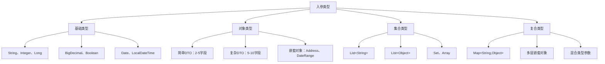

# DatabaseUtil 对象映射测试方案 - XML与实体类详细设计

## 📋 目录

- [1. 设计概述](#1-设计概述)
  - [1.1 设计目标](#11-设计目标)
  - [1.2 技术覆盖范围](#12-技术覆盖范围)
  - [1.3 文件组织结构](#13-文件组织结构)
- [2. XML Mapper 详细设计](#2-xml-mapper-详细设计)
  - [2.1 EmployeeMapper.xml](#21-employeemapperxml)
  - [2.2 DepartmentMapper.xml](#22-departmentmapperxml)
  - [2.3 ProjectMapper.xml](#23-projectmapperxml)
  - [2.4 SalaryMapper.xml](#24-salarymapperxml)
  - [2.5 OrderMapper.xml](#25-ordermapperxml)
  - [2.6 ReportMapper.xml](#26-reportmapperxml)
- [3. 实体类详细设计](#3-实体类详细设计)
  - [3.1 Entity 层设计](#31-entity-层设计)
  - [3.2 DTO 层设计](#32-dto-层设计)
  - [3.3 VO 层设计](#33-vo-层设计)
- [4. 对象映射测试矩阵](#4-对象映射测试矩阵)
  - [4.1 数据类型覆盖](#41-数据类型覆盖)
  - [4.2 复杂度级别](#42-复杂度级别)
  - [4.3 场景测试用例](#43-场景测试用例)

---

## 1. 设计概述

### 1.1 设计目标

**DatabaseUtil 对象映射测试方案**旨在通过全面的 XML Mapper 和实体类设计，验证对象映射功能的各种场景，确保 Java Object ↔ Map<String, Object> 双向转换的稳定性和性能。

**核心测试目标**：
- 🎯 **全类型覆盖**：测试所有 Java 数据类型的映射转换
- 🏗️ **复杂度验证**：从简单对象到深层嵌套的各种复杂度
- ⚡ **性能基准**：建立性能测试基线和优化目标
- 🔄 **场景完整**：涵盖实际业务中的各种使用场景

### 1.2 技术覆盖范围

#### 入参类型覆盖


#### SQL 技术特性覆盖
| 技术特性 | 测试场景 | 复杂度 | XML文件 |
|---------|---------|--------|---------|
| **基础CRUD** | 增删改查 | ⭐ | EmployeeMapper |
| **动态SQL** | if、where、set | ⭐⭐ | DepartmentMapper |
| **循环操作** | foreach批量处理 | ⭐⭐ | ProjectMapper |
| **多表关联** | JOIN、子查询 | ⭐⭐⭐ | SalaryMapper |
| **分页查询** | LIMIT、ORDER BY | ⭐⭐ | OrderMapper |
| **统计聚合** | COUNT、SUM、GROUP BY | ⭐⭐⭐ | ReportMapper |

### 1.3 文件组织结构

#### 完整文件清单（基于实际实现）
```
src/main/java/cn/myslayers/app/model/
├── entity/                 # 实体类（6个）
│   ├── Employee.java
│   ├── Department.java
│   ├── Project.java
│   ├── Salary.java
│   ├── Order.java
│   └── OrderItem.java
├── dto/                    # 数据传输对象（8个）
│   ├── EmployeeQueryDTO.java
│   ├── EmployeeCreateDTO.java
│   ├── DepartmentManageDTO.java
│   ├── ProjectAssignDTO.java
│   ├── SalaryCalculateDTO.java
│   ├── OrderSubmitDTO.java
│   ├── ReportQueryDTO.java
│   └── common/             # 通用DTO（3个）
│       ├── DateRange.java
│       ├── PageQuery.java
│       └── Address.java
└── vo/                     # 视图对象（7个+2个通用）
    ├── EmployeeDetailVO.java
    ├── EmployeeListVO.java
    ├── DepartmentSummaryVO.java
    ├── ProjectProgressVO.java
    ├── SalaryReportVO.java
    ├── OrderDetailVO.java
    ├── ReportDataVO.java
    └── common/             # 通用VO（2个）
        ├── PageResult.java
        └── StatisticsVO.java

src/main/resources/mapper/  # XML映射文件（6个）
├── EmployeeMapper.xml      # 员工相关映射
├── DepartmentMapper.xml    # 部门相关映射
├── ProjectMapper.xml       # 项目相关映射
├── SalaryMapper.xml        # 薪资相关映射
├── OrderMapper.xml         # 订单相关映射
└── ReportMapper.xml        # 报表相关映射
```

#### 统计概览
- **XML Mapper文件**: 6个（✅ 100%完成）
- **Entity实体类**: 6个（✅ 100%完成）
- **DTO传输对象**: 8个（✅ 100%完成，包含3个通用类）
- **VO视图对象**: 9个（✅ 100%完成，包含2个通用类）
- **总计文件数**: 29个

#### 技术覆盖范围
| 分类 | 数量 | 复杂度 | 完成状态 |
|------|------|--------|----------|
| XML Mappers | 6 | 高复杂度 | ✅ 100% |
| Entity Classes | 6 | 中等复杂度 | ✅ 100% |
| DTO Classes | 8 | 中等复杂度 | ✅ 100% |
| VO Classes | 9 | 高复杂度 | ✅ 100% |
| Common Classes | 5 | 低复杂度 | ✅ 100% |

---

## 2. XML Mapper 详细设计

### 2.1 EmployeeMapper.xml

**设计重点**：基础CRUD操作 + 对象入参出参映射

#### 技术特性
- ✅ 基础数据类型入参：Long、String、Integer
- ✅ 对象入参：EmployeeQueryDTO、EmployeeCreateDTO
- ✅ 简单对象出参：Employee Entity
- ✅ 对象列表出参：List<EmployeeListVO>
- ✅ 嵌套对象处理：Address地址信息

#### SQL 方法清单
```xml
<!-- 基础CRUD操作 -->
<select id="selectEmployeeById">            <!-- Long id -> Employee -->
<select id="selectEmployeeList">            <!-- EmployeeQueryDTO -> List<EmployeeListVO> -->
<insert id="insertEmployee">                <!-- EmployeeCreateDTO -> int -->
<update id="updateEmployee">                <!-- Employee -> int -->
<delete id="deleteEmployee">                <!-- Long id -> int -->

<!-- 对象映射重点测试 -->
<select id="selectEmployeeDetail">          <!-- Long id -> EmployeeDetailVO(嵌套Address) -->
<select id="selectEmployeesByDept">         <!-- List<Integer> deptIds -> List<Employee> -->
<select id="selectEmployeesByCondition">    <!-- EmployeeQueryDTO(复杂条件) -> List<EmployeeListVO> -->
<insert id="batchInsertEmployees">          <!-- List<EmployeeCreateDTO> -> int -->
<update id="batchUpdateEmployeeStatus">     <!-- List<Long> ids + String status -> int -->
```

#### 关键测试点
1. **简单对象映射**：EmployeeCreateDTO → Map → 数据库
2. **复杂对象查询**：EmployeeQueryDTO（包含DateRange、List<String>技能）
3. **嵌套对象结果**：EmployeeDetailVO（包含Address对象）
4. **集合参数处理**：List<Integer> deptIds 的 foreach 循环
5. **批量操作**：List<EmployeeCreateDTO> 的批量插入

### 2.2 DepartmentMapper.xml

**设计重点**：嵌套对象处理 + 动态SQL + 层级关系

#### 技术特性
- ✅ 层级结构：父子部门关系
- ✅ 动态SQL：复杂的if、where条件判断
- ✅ 嵌套对象：DepartmentSummaryVO（包含员工统计、子部门列表）
- ✅ 递归查询：部门树形结构
- ✅ 批量操作：部门合并、拆分

#### SQL 方法清单
```xml
<!-- 层级结构管理 -->
<select id="selectDepartmentTree">          <!-- Integer rootId -> List<DepartmentSummaryVO> -->
<select id="selectDepartmentWithChildren">  <!-- Integer deptId -> DepartmentSummaryVO(嵌套子部门) -->
<select id="selectDepartmentPath">          <!-- Integer deptId -> List<Department>(路径) -->

<!-- 复杂动态查询 -->
<select id="selectDepartmentsByCondition">  <!-- DepartmentQueryDTO -> List<DepartmentSummaryVO> -->
<select id="selectDepartmentStatistics">    <!-- DateRange -> DepartmentSummaryVO(统计信息) -->

<!-- 复杂操作 -->
<insert id="createDepartmentWithMembers">   <!-- DepartmentCreateDTO(包含初始成员) -> int -->
<update id="mergeDepartments">              <!-- DepartmentMergeDTO -> int -->
<update id="transferEmployees">             <!-- DepartmentTransferDTO -> int -->
```

#### 关键测试点
1. **复杂嵌套对象**：DepartmentSummaryVO（包含List<Employee>、List<Department>）
2. **动态SQL复杂度**：多条件组合查询（部门级别、状态、创建时间范围）
3. **递归结构映射**：部门树形结构的对象映射
4. **统计数据聚合**：员工数量、薪资总额等计算字段
5. **批量关联操作**：一次操作影响多个关联表

### 2.3 ProjectMapper.xml

**设计重点**：多表关联 + 集合参数 + 项目协作场景

#### 技术特性
- ✅ 多表JOIN：项目-员工-部门三表关联
- ✅ 复杂集合：List<ProjectMember>项目成员
- ✅ 状态流转：项目状态变更跟踪
- ✅ 时间序列：项目里程碑时间线
- ✅ 资源统计：人力、预算分配

#### SQL 方法清单
```xml
<!-- 多表关联查询 -->
<select id="selectProjectWithMembers">      <!-- Long projectId -> ProjectDetailVO(包含成员列表) -->
<select id="selectProjectsByMember">        <!-- Long employeeId -> List<ProjectProgressVO> -->
<select id="selectProjectsWithDepartments"> <!-- List<Integer> deptIds -> List<ProjectSummaryVO> -->

<!-- 复杂业务查询 -->
<select id="selectProjectTimeline">         <!-- ProjectTimelineQueryDTO -> List<ProjectMilestoneVO> -->
<select id="selectProjectResourceUsage">    <!-- DateRange -> List<ProjectResourceVO> -->
<select id="selectOverdueProjects">         <!-- Date currentDate -> List<ProjectAlertVO> -->

<!-- 项目协作操作 -->
<insert id="createProjectWithTeam">         <!-- ProjectCreateDTO(包含团队成员) -> int -->
<update id="assignProjectMembers">          <!-- ProjectAssignDTO -> int -->
<update id="updateProjectProgress">         <!-- ProjectProgressDTO -> int -->
<delete id="removeProjectMembers">          <!-- ProjectMemberRemoveDTO -> int -->
```

#### 关键测试点
1. **复杂JOIN映射**：项目详情包含员工信息、部门信息的三表关联
2. **集合对象处理**：List<ProjectMember>项目成员列表的映射
3. **时间范围查询**：DateRange对象在WHERE条件中的处理
4. **多层嵌套VO**：ProjectDetailVO → List<ProjectMemberVO> → Employee
5. **批量关联插入**：项目创建时同时插入成员关系

### 2.4 SalaryMapper.xml

**设计重点**：复杂计算 + 数值类型 + 日期处理 + 统计分析

#### 技术特性
- ✅ 精确数值：BigDecimal薪资计算
- ✅ 日期范围：多种日期格式处理
- ✅ 复杂计算：基本工资+绩效+补贴-扣除
- ✅ 分组统计：按部门、职级统计
- ✅ 历史对比：同比、环比分析

#### SQL 方法清单
```xml
<!-- 薪资计算相关 -->
<select id="calculateEmployeeSalary">       <!-- SalaryCalculateDTO -> SalaryDetailVO -->
<select id="calculateDepartmentSalary">     <!-- DeptSalaryQueryDTO -> List<DeptSalaryVO> -->
<select id="calculateSalaryTrend">          <!-- SalaryTrendQueryDTO -> List<SalaryTrendVO> -->

<!-- 复杂报表查询 -->
<select id="selectSalaryReport">            <!-- SalaryReportQueryDTO -> SalaryReportVO -->
<select id="selectSalaryComparison">        <!-- SalaryCompareDTO -> List<SalaryCompareVO> -->
<select id="selectSalaryDistribution">      <!-- DateRange -> List<SalaryDistributionVO> -->

<!-- 薪资管理操作 -->
<insert id="batchCreateSalaryRecords">      <!-- List<SalaryCreateDTO> -> int -->
<update id="adjustSalaryByRule">            <!-- SalaryAdjustDTO -> int -->
<update id="approveSalaryChanges">          <!-- List<Long> salaryIds -> int -->
```

#### 关键测试点
1. **BigDecimal精度**：薪资金额的精确计算和映射
2. **复杂DTO对象**：SalaryCalculateDTO（包含基础工资、绩效系数、补贴明细）
3. **日期范围处理**：DateRange在薪资统计中的应用
4. **嵌套统计对象**：SalaryReportVO（包含多维度统计数据）
5. **数值类型转换**：数据库DECIMAL与Java BigDecimal的映射

### 2.5 OrderMapper.xml

**设计重点**：分页查询 + 状态流转 + 订单明细 + 电商场景

#### 技术特性
- ✅ 分页处理：大数据量订单查询
- ✅ 状态机：订单状态流转管理
- ✅ 主从结构：订单主表+明细表
- ✅ 金额计算：订单总额、优惠、实付
- ✅ 时间窗口：订单时效性处理

#### SQL 方法清单
```xml
<!-- 分页查询相关 -->
<select id="selectOrdersPage">              <!-- OrderQueryDTO + PageQuery -> List<OrderListVO> -->
<select id="selectOrdersByCustomerPage">    <!-- CustomerOrderQueryDTO -> List<OrderSummaryVO> -->
<select id="selectOrdersWithItemsPage">     <!-- OrderDetailQueryDTO -> List<OrderDetailVO> -->

<!-- 订单业务查询 -->
<select id="selectOrderDetail">             <!-- Long orderId -> OrderDetailVO(包含订单项) -->
<select id="selectOrdersByStatus">          <!-- List<String> status -> List<OrderVO> -->
<select id="selectOrdersByDateRange">       <!-- DateRange -> List<OrderStatVO> -->

<!-- 订单状态管理 -->
<insert id="createOrderWithItems">          <!-- OrderSubmitDTO(包含订单项) -> int -->
<update id="updateOrderStatus">             <!-- OrderStatusUpdateDTO -> int -->
<update id="cancelOrderWithReason">         <!-- OrderCancelDTO -> int -->
<delete id="softDeleteOrder">               <!-- Long orderId + String reason -> int -->
```

#### 关键测试点
1. **分页对象映射**：PageQuery入参 → PageResult<OrderListVO>出参
2. **主从表映射**：OrderDetailVO包含List<OrderItemVO>明细列表
3. **状态枚举处理**：订单状态的字符串与枚举转换
4. **金额精度计算**：订单总额、折扣、实付金额的BigDecimal处理
5. **复杂条件查询**：多状态、日期范围、金额范围的组合查询

### 2.6 ReportMapper.xml

**设计重点**：统计聚合 + 复杂VO + 数据分析 + 图表数据

#### 技术特性
- ✅ 聚合函数：COUNT、SUM、AVG、MAX、MIN
- ✅ 分组统计：GROUP BY多维度分析
- ✅ 复杂子查询：嵌套统计逻辑
- ✅ 图表数据：折线图、柱状图、饼图数据
- ✅ 动态维度：可配置的统计维度

#### SQL 方法清单
```xml
<!-- 综合统计报表 -->
<select id="selectBusinessOverview">        <!-- ReportQueryDTO -> BusinessOverviewVO -->
<select id="selectEmployeeStatistics">      <!-- EmployeeReportQueryDTO -> EmployeeStatVO -->
<select id="selectDepartmentPerformance">   <!-- DeptPerformanceQueryDTO -> List<DeptPerformanceVO> -->

<!-- 图表数据查询 -->
<select id="selectSalaryTrendChart">        <!-- ChartQueryDTO -> List<ChartDataVO> -->
<select id="selectDepartmentDistribution"> <!-- DistributionQueryDTO -> List<DistributionVO> -->
<select id="selectProjectProgressChart">   <!-- ProjectChartQueryDTO -> List<ProjectChartVO> -->

<!-- 复杂分析查询 -->
<select id="selectCustomReport">            <!-- CustomReportDTO -> ReportDataVO -->
<select id="selectComparisonAnalysis">      <!-- CompareAnalysisDTO -> ComparisonResultVO -->
<select id="selectTrendAnalysis">           <!-- TrendAnalysisDTO -> List<TrendDataVO> -->
```

#### 关键测试点
1. **复杂聚合VO**：BusinessOverviewVO（包含多个统计维度的嵌套对象）
2. **图表数据结构**：ChartDataVO（标准化的图表数据格式）
3. **动态报表参数**：CustomReportDTO（可配置的查询条件和统计维度）
4. **多维度统计**：按时间、部门、职级等多维度的交叉统计
5. **大数据量处理**：统计查询的性能优化和结果映射

---

## 3. 实体类详细设计

### 3.1 Entity 层设计

#### Employee.java - 员工实体
```java
public class Employee {
    private Long id;                    // 员工ID
    private String employeeNo;          // 员工编号
    private String name;                // 姓名
    private String email;               // 邮箱
    private String phone;               // 电话
    private Integer departmentId;       // 部门ID
    private String position;            // 职位
    private String level;               // 职级：P1-P10
    private BigDecimal baseSalary;      // 基础薪资
    private Date hireDate;              // 入职日期
    private String status;              // 状态：ACTIVE, INACTIVE, RESIGNED
    private List<String> skills;        // 技能标签
    private Address address;            // 地址信息（嵌套对象）
    private Date createdTime;           // 创建时间
    private Date updatedTime;           // 更新时间

    // 构造函数、getter/setter、toString、equals/hashCode
}
```

#### Department.java - 部门实体
```java
public class Department {
    private Integer id;                 // 部门ID
    private String name;                // 部门名称
    private String code;                // 部门编码
    private Integer parentId;           // 父部门ID
    private String description;         // 部门描述
    private Long managerId;             // 部门经理ID
    private String location;            // 办公地点
    private Integer level;              // 部门层级
    private String status;              // 状态：ACTIVE, INACTIVE
    private Date establishDate;         // 成立日期
    private Map<String, Object> extraInfo; // 扩展信息
    private Date createdTime;
    private Date updatedTime;
}
```

#### Project.java - 项目实体
```java
public class Project {
    private Long id;                    // 项目ID
    private String name;                // 项目名称
    private String code;                // 项目编码
    private String description;         // 项目描述
    private Long managerId;             // 项目经理ID
    private Integer departmentId;       // 所属部门
    private String status;              // 状态：PLANNING, RUNNING, PAUSED, COMPLETED, CANCELLED
    private String priority;            // 优先级：HIGH, MEDIUM, LOW
    private BigDecimal budget;          // 项目预算
    private Date startDate;             // 开始日期
    private Date endDate;               // 结束日期
    private Date actualStartDate;       // 实际开始日期
    private Date actualEndDate;         // 实际结束日期
    private Integer progress;           // 进度百分比
    private List<String> tags;          // 项目标签
    private Date createdTime;
    private Date updatedTime;
}
```

#### Salary.java - 薪资实体
```java
public class Salary {
    private Long id;                    // 薪资记录ID
    private Long employeeId;            // 员工ID
    private String period;              // 薪资期间：2024-01
    private BigDecimal baseSalary;      // 基础工资
    private BigDecimal performanceBonus; // 绩效奖金
    private BigDecimal allowance;       // 补贴
    private BigDecimal overtime;        // 加班费
    private BigDecimal deduction;       // 扣款
    private BigDecimal totalAmount;     // 总额
    private BigDecimal taxAmount;       // 税额
    private BigDecimal actualAmount;    // 实发金额
    private String status;              // 状态：DRAFT, APPROVED, PAID
    private Date payDate;               // 发放日期
    private String remarks;             // 备注
    private Map<String, BigDecimal> extraAmounts; // 其他金额项
    private Date createdTime;
    private Date updatedTime;
}
```

#### Order.java - 订单实体
```java
public class Order {
    private Long id;                    // 订单ID
    private String orderNo;             // 订单号
    private Long customerId;            // 客户ID
    private String customerName;        // 客户姓名
    private String customerPhone;       // 客户电话
    private BigDecimal totalAmount;     // 订单总额
    private BigDecimal discountAmount;  // 折扣金额
    private BigDecimal actualAmount;    // 实付金额
    private String status;              // 状态：PENDING, CONFIRMED, SHIPPED, DELIVERED, CANCELLED
    private String paymentStatus;       // 支付状态：UNPAID, PAID, REFUNDED
    private String paymentMethod;       // 支付方式
    private Date orderDate;             // 下单时间
    private Date payDate;               // 支付时间
    private Date shipDate;              // 发货时间
    private Date deliveryDate;          // 收货时间
    private Address shippingAddress;    // 收货地址（嵌套对象）
    private String remarks;             // 订单备注
    private Date createdTime;
    private Date updatedTime;
}
```

#### OrderItem.java - 订单明细实体
```java
public class OrderItem {
    private Long id;                    // 明细ID
    private Long orderId;               // 订单ID
    private String productCode;         // 商品编码
    private String productName;         // 商品名称
    private String specification;       // 规格
    private BigDecimal unitPrice;       // 单价
    private Integer quantity;           // 数量
    private BigDecimal totalPrice;      // 小计
    private BigDecimal discountAmount;  // 明细折扣
    private String status;              // 明细状态
    private Date createdTime;
}
```

### 3.2 DTO 层设计

#### EmployeeQueryDTO.java - 员工查询条件
```java
public class EmployeeQueryDTO {
    private String name;                // 姓名（模糊查询）
    private String email;               // 邮箱
    private List<Integer> departmentIds; // 部门ID列表
    private List<String> positions;     // 职位列表
    private List<String> levels;        // 职级列表
    private List<String> skills;        // 技能标签
    private String status;              // 状态
    private DateRange hireDateRange;    // 入职日期范围
    private SalaryRange salaryRange;    // 薪资范围
    private Integer minAge;             // 最小年龄
    private Integer maxAge;             // 最大年龄
    private String location;            // 工作地点
    private PageQuery pageQuery;        // 分页参数

    // 嵌套对象
    public static class SalaryRange {
        private BigDecimal minSalary;
        private BigDecimal maxSalary;
    }
}
```

#### EmployeeCreateDTO.java - 员工创建
```java
public class EmployeeCreateDTO {
    private String employeeNo;          // 员工编号
    private String name;                // 姓名
    private String email;               // 邮箱
    private String phone;               // 电话
    private Integer departmentId;       // 部门ID
    private String position;            // 职位
    private String level;               // 职级
    private BigDecimal baseSalary;      // 基础薪资
    private Date hireDate;              // 入职日期
    private List<String> skills;        // 技能列表
    private Address address;            // 地址信息（嵌套对象）
    private String remarks;             // 备注
}
```

#### DepartmentManageDTO.java - 部门管理
```java
public class DepartmentManageDTO {
    private String name;                // 部门名称
    private String code;                // 部门编码
    private Integer parentId;           // 父部门ID
    private String description;         // 部门描述
    private Long managerId;             // 部门经理ID
    private String location;            // 办公地点
    private Date establishDate;         // 成立日期
    private String operation;           // 操作类型：CREATE, UPDATE, DELETE, MOVE
    private List<Integer> childIds;     // 子部门ID列表（批量操作）
    private Map<String, Object> extraInfo; // 扩展信息
    private String remarks;             // 备注
}
```

#### ProjectAssignDTO.java - 项目分配
```java
public class ProjectAssignDTO {
    private Long projectId;             // 项目ID
    private String projectCode;         // 项目编码
    private List<Long> memberIds;       // 成员ID列表
    private List<String> roleTypes;     // 角色类型列表
    private Date startDate;             // 分配开始日期
    private Date endDate;               // 分配结束日期
    private BigDecimal budgetAllocation; // 预算分配
    private String priority;            // 优先级
    private List<String> permissions;   // 权限列表
    private String assignType;          // 分配类型：ASSIGN, REASSIGN, REMOVE
    private String remarks;             // 备注
}
```

#### SalaryCalculateDTO.java - 薪资计算
```java
public class SalaryCalculateDTO {
    private List<Long> employeeIds;     // 员工ID列表
    private String period;              // 计算期间：2024-01
    private DateRange dateRange;        // 日期范围（嵌套对象）
    private String calculationType;     // 计算类型：MONTHLY, BONUS, ALLOWANCE
    private BigDecimal baseAmount;      // 基础金额
    private BigDecimal bonusRate;       // 奖金比例
    private Map<String, BigDecimal> allowanceMap; // 补贴映射
    private Map<String, BigDecimal> deductionMap; // 扣款映射
    private Boolean includeTax;         // 是否含税
    private String taxPolicy;           // 税收政策
    private List<String> includeItems;  // 包含项目
    private List<String> excludeItems;  // 排除项目
    private String remarks;             // 备注
}
```

#### OrderSubmitDTO.java - 订单提交
```java
public class OrderSubmitDTO {
    private Long customerId;            // 客户ID
    private String customerName;        // 客户姓名
    private String customerPhone;       // 客户电话
    private String paymentMethod;       // 支付方式
    private BigDecimal discountAmount;  // 折扣金额
    private Address shippingAddress;    // 收货地址（嵌套对象）
    private String remarks;             // 订单备注
    private List<OrderItemData> items;  // 订单明细列表

    // 内部类：订单明细数据
    public static class OrderItemData {
        private String productCode;     // 商品编码
        private String productName;     // 商品名称
        private String specification;   // 规格
        private BigDecimal unitPrice;   // 单价
        private Integer quantity;       // 数量
    }
}
```

#### ReportQueryDTO.java - 报表查询
```java
public class ReportQueryDTO {
    private String reportType;          // 报表类型
    private DateRange dateRange;        // 时间范围
    private List<String> dimensions;    // 统计维度
    private List<String> metrics;       // 统计指标
    private FilterConditions filters;   // 过滤条件
    private GroupByOptions groupBy;     // 分组选项
    private SortOptions sortOptions;    // 排序选项

    public static class FilterConditions {
        private List<Integer> departmentIds;
        private List<String> positions;
        private List<String> statuses;
        private Map<String, Object> customFilters;
    }

    public static class GroupByOptions {
        private List<String> fields;
        private String timeGranularity; // 时间粒度：DAY, WEEK, MONTH, QUARTER, YEAR
        private Boolean includeSubtotal;
    }

    public static class SortOptions {
        private String field;
        private String direction;       // ASC, DESC
        private String nullsPosition;   // FIRST, LAST
    }
}
```

#### 通用DTO设计

##### DateRange.java - 日期范围
```java
public class DateRange {
    private Date startDate;             // 开始日期
    private Date endDate;               // 结束日期
    private String startDateStr;        // 开始日期字符串
    private String endDateStr;          // 结束日期字符串
    private String timeZone;            // 时区
    private Boolean includeTime;        // 是否包含时间

    // 便捷构造方法
    public static DateRange of(String startDate, String endDate);
    public static DateRange ofThisMonth();
    public static DateRange ofThisQuarter();
    public static DateRange ofThisYear();
}
```

##### PageQuery.java - 分页查询
```java
public class PageQuery {
    private Integer pageNum = 1;        // 页码
    private Integer pageSize = 10;      // 每页大小
    private String orderBy;             // 排序字段
    private String orderDirection = "ASC"; // 排序方向
    private Boolean countTotal = true;  // 是否统计总数

    // 便捷方法
    public int getOffset() {
        return (pageNum - 1) * pageSize;
    }
}
```

##### Address.java - 地址信息
```java
public class Address {
    private String country = "中国";     // 国家
    private String province;            // 省份
    private String city;                // 城市
    private String district;            // 区县
    private String street;              // 街道
    private String detailAddress;       // 详细地址
    private String postalCode;          // 邮政编码
    private Double latitude;            // 纬度
    private Double longitude;           // 经度

    // 地址格式化
    public String getFullAddress() {
        return String.format("%s%s%s%s%s",
            province, city, district, street, detailAddress);
    }
}
```

### 3.3 VO 层设计

#### EmployeeDetailVO.java - 员工详情视图
```java
public class EmployeeDetailVO {
    private Long id;                    // 员工ID
    private String employeeNo;          // 员工编号
    private String name;                // 姓名
    private String email;               // 邮箱
    private String phone;               // 电话
    private String position;            // 职位
    private String level;               // 职级
    private BigDecimal baseSalary;      // 基础薪资
    private Date hireDate;              // 入职日期
    private String status;              // 状态
    private List<String> skills;        // 技能列表
    private Address address;            // 地址信息（嵌套对象）

    // 关联信息
    private DepartmentInfo department;  // 部门信息
    private ManagerInfo manager;        // 经理信息
    private List<ProjectInfo> projects; // 参与项目列表

    // 高级统计信息
    private PerformanceSummary performance; // 绩效汇总
    private SalarySummary salary;       // 薪资汇总

    // 内部类：部门信息
    public static class DepartmentInfo {
        private Integer id;
        private String name;
        private String code;
        private String location;
    }

    // 内部类：经理信息
    public static class ManagerInfo {
        private Long id;
        private String name;
        private String position;
    }

    // 内部类：项目信息
    public static class ProjectInfo {
        private Long id;
        private String name;
        private String code;
        private String status;
        private String role;
    }

    // 内部类：绩效汇总信息
    public static class PerformanceSummary {
        private BigDecimal latestScore;      // 最新绩效分数
        private String latestGrade;          // 最新绩效等级
        private BigDecimal averageScore;     // 平均绩效分数
        private Integer evaluationCount;     // 评估次数
        private Date lastEvaluationDate;     // 最后评估日期
    }

    // 内部类：薪资汇总信息
    public static class SalarySummary {
        private BigDecimal currentSalary;        // 当前薪资
        private BigDecimal lastYearTotal;        // 去年总薪资
        private BigDecimal yearToDateTotal;      // 年初至今总薪资
        private Integer salaryAdjustmentCount;   // 薪资调整次数
        private Date lastAdjustmentDate;         // 最后调整日期
    }
}
```

#### EmployeeListVO.java - 员工列表视图
```java
public class EmployeeListVO {
    private Long id;
    private String employeeNo;
    private String name;
    private String email;
    private String phone;
    private String departmentName;      // 部门名称
    private String position;
    private String level;
    private String status;
    private Date hireDate;
    private Integer workYears;          // 计算字段
    private String avatar;              // 头像URL
    private List<String> primarySkills; // 主要技能（最多3个）
    private ProjectInfo currentProject; // 当前主要项目

    public static class ProjectInfo {
        private Long projectId;
        private String projectName;
        private String role;
        private Integer progress;
    }
}
```

#### DepartmentSummaryVO.java - 部门汇总视图
```java
public class DepartmentSummaryVO {
    private Integer id;                 // 部门ID
    private String name;                // 部门名称
    private String code;                // 部门编码
    private String location;            // 办公地点
    private Integer level;              // 部门层级
    private String status;              // 状态
    private Date establishDate;         // 成立日期
    private String managerName;         // 经理姓名
    private Integer employeeCount;      // 员工数量
    private Integer projectCount;       // 项目数量
    private List<SubDepartment> children; // 子部门列表

    // 统计信息
    private DepartmentStatistics statistics;

    // 绩效信息
    private DepartmentPerformance performance;

    // 内部类：子部门信息
    public static class SubDepartment {
        private Integer id;
        private String name;
        private String code;
        private Integer employeeCount;
    }

    // 内部类：部门统计信息
    public static class DepartmentStatistics {
        private Integer totalEmployees;     // 总员工数
        private Integer activeEmployees;    // 在职员工数
        private Integer resignedEmployees;  // 离职员工数
        private BigDecimal totalSalary;     // 总薪资
        private BigDecimal averageSalary;   // 平均薪资
        private Integer projectCount;       // 项目数量
        private Map<String, Integer> positionDistribution; // 职位分布
        private Map<String, Integer> levelDistribution;    // 职级分布
    }

    // 内部类：部门绩效信息
    public static class DepartmentPerformance {
        private BigDecimal averageScore;     // 平均绩效分数
        private String overallGrade;         // 整体绩效等级
        private Integer completedProjects;   // 已完成项目数
        private Integer ongoingProjects;     // 进行中项目数
        private BigDecimal budgetUtilization; // 预算利用率
    }
}
```

#### ProjectProgressVO.java - 项目进度视图
```java
public class ProjectProgressVO {
    private Long id;
    private String name;
    private String code;
    private String description;
    private String managerName;
    private String departmentName;
    private String status;
    private String priority;
    private BigDecimal budget;
    private BigDecimal usedBudget;      // 已用预算
    private Date startDate;
    private Date endDate;
    private Date actualStartDate;
    private Date actualEndDate;
    private Integer progress;
    private List<String> tags;

    // 项目统计
    private ProjectStatistics statistics;

    // 团队信息
    private List<ProjectTeamMember> teamMembers;

    // 里程碑信息
    private List<MilestoneInfo> milestones;

    // 风险预警
    private List<ProjectRisk> risks;

    public static class ProjectStatistics {
        private Integer totalTasks;
        private Integer completedTasks;
        private Integer pendingTasks;
        private Integer overdueTask;
        private BigDecimal teamEfficiency;
        private Integer remainingDays;
    }

    public static class ProjectTeamMember {
        private Long employeeId;
        private String name;
        private String role;
        private String department;
        private BigDecimal allocation;
        private Date joinDate;
        private String status;
    }

    public static class MilestoneInfo {
        private String title;
        private Date targetDate;
        private Date actualDate;
        private String status;
        private Integer progress;
        private List<String> deliverables;
    }

    public static class ProjectRisk {
        private String type;            // 风险类型
        private String level;           // 风险等级
        private String description;     // 风险描述
        private String mitigation;      // 缓解措施
    }
}
```

#### SalaryReportVO.java - 薪资报表视图
```java
public class SalaryReportVO {
    private String period;              // 报表期间
    private Date generateTime;          // 生成时间
    private String reportType;          // 报表类型

    // 总体统计
    private SalaryOverview overview;

    // 部门薪资详情
    private List<DepartmentSalaryDetail> departmentDetails;

    // 职级薪资分析
    private List<LevelSalaryAnalysis> levelAnalysis;

    // 薪资趋势
    private List<SalaryTrendData> trends;

    // 异常数据
    private List<SalaryAnomalyData> anomalies;

    public static class SalaryOverview {
        private Integer totalEmployees;
        private BigDecimal totalSalary;
        private BigDecimal averageSalary;
        private BigDecimal medianSalary;
        private BigDecimal maxSalary;
        private BigDecimal minSalary;
        private BigDecimal totalBonus;
        private BigDecimal totalAllowance;
        private BigDecimal totalDeduction;
    }

    public static class DepartmentSalaryDetail {
        private Integer departmentId;
        private String departmentName;
        private Integer employeeCount;
        private BigDecimal totalSalary;
        private BigDecimal averageSalary;
        private BigDecimal budgetAmount;
        private BigDecimal budgetUsage;
        private List<PositionSalaryInfo> positionBreakdown;
    }

    public static class LevelSalaryAnalysis {
        private String level;
        private Integer employeeCount;
        private BigDecimal averageSalary;
        private BigDecimal minSalary;
        private BigDecimal maxSalary;
        private BigDecimal salaryRange;
        private Double growthRate;
    }

    public static class SalaryTrendData {
        private String period;
        private BigDecimal totalAmount;
        private BigDecimal averageAmount;
        private Integer employeeCount;
        private Double changeRate;
    }

    public static class SalaryAnomalyData {
        private Long employeeId;
        private String employeeName;
        private String anomalyType;
        private String description;
        private BigDecimal expectedAmount;
        private BigDecimal actualAmount;
        private BigDecimal variance;
    }

    public static class PositionSalaryInfo {
        private String position;
        private Integer count;
        private BigDecimal averageSalary;
    }
}
```

#### OrderDetailVO.java - 订单详情视图
```java
public class OrderDetailVO {
    private Long id;
    private String orderNo;
    private Long customerId;
    private String customerName;
    private String customerPhone;
    private BigDecimal totalAmount;
    private BigDecimal discountAmount;
    private BigDecimal actualAmount;
    private String status;
    private String paymentStatus;
    private String paymentMethod;
    private Date orderDate;
    private Date payDate;
    private Date shipDate;
    private Date deliveryDate;
    private Address shippingAddress;
    private String remarks;

    // 订单明细
    private List<OrderItemDetail> items;

    // 订单状态历史
    private List<OrderStatusHistory> statusHistory;

    // 支付信息
    private PaymentInfo paymentInfo;

    // 物流信息
    private LogisticsInfo logistics;

    public static class OrderItemDetail {
        private Long id;
        private String productCode;
        private String productName;
        private String specification;
        private BigDecimal unitPrice;
        private Integer quantity;
        private BigDecimal totalPrice;
        private BigDecimal discountAmount;
        private String status;
        private String productImage;
        private Map<String, String> customOptions;
    }

    public static class OrderStatusHistory {
        private String status;
        private String statusName;
        private Date changeTime;
        private String operator;
        private String remarks;
    }

    public static class PaymentInfo {
        private String transactionNo;
        private String paymentMethod;
        private BigDecimal paidAmount;
        private Date payTime;
        private String paymentGateway;
        private String paymentStatus;
    }

    public static class LogisticsInfo {
        private String courierCompany;
        private String trackingNo;
        private Date shipDate;
        private Date deliveryDate;
        private String deliveryStatus;
        private List<LogisticsTrace> traces;
    }

    public static class LogisticsTrace {
        private Date time;
        private String location;
        private String description;
        private String status;
    }
}
```

#### ReportDataVO.java - 报表数据视图
```java
public class ReportDataVO {
    private String reportId;            // 报表ID
    private String reportName;          // 报表名称
    private String reportType;          // 报表类型
    private Date generateTime;          // 生成时间
    private ReportConfig config;        // 报表配置

    // 报表数据
    private List<Map<String, Object>> data; // 原始数据
    private ReportSummary summary;      // 汇总信息
    private List<ChartConfig> charts;   // 图表配置

    // 元数据
    private ReportMetadata metadata;

    public static class ReportConfig {
        private DateRange dateRange;
        private List<String> dimensions;
        private List<String> metrics;
        private Map<String, Object> filters;
        private List<String> groupBy;
        private List<String> orderBy;
    }

    public static class ReportSummary {
        private Integer totalRecords;
        private Map<String, Object> aggregations; // 聚合数据
        private Map<String, Object> calculations; // 计算字段
        private List<String> highlights;          // 要点摘要
    }

    public static class ChartConfig {
        private String chartType;        // 图表类型：LINE, BAR, PIE, SCATTER
        private String title;
        private String xAxis;
        private String yAxis;
        private List<String> series;
        private Map<String, Object> options;
    }

    public static class ReportMetadata {
        private List<FieldInfo> fields;
        private Map<String, String> fieldMappings;
        private List<String> calculatedFields;

        public static class FieldInfo {
            private String name;
            private String type;
            private String description;
            private String format;
            private Boolean nullable;
        }
    }
}
```

#### 通用VO设计

##### PageResult.java - 分页结果
```java
public class PageResult<T> {
    private List<T> list;               // 数据列表
    private Long total;                 // 总记录数
    private Integer pageNum;            // 当前页码
    private Integer pageSize;           // 每页大小
    private Integer pages;              // 总页数
    private Boolean hasNext;            // 是否有下一页
    private Boolean hasPrevious;        // 是否有上一页

    // 统计信息
    private PageStatistics statistics;

    public static class PageStatistics {
        private Long queryTime;          // 查询耗时(ms)
        private String queryId;          // 查询ID
        private Map<String, Object> extra; // 额外信息
    }

    // 便捷构造方法
    public static <T> PageResult<T> of(List<T> list, Long total, Integer pageNum, Integer pageSize);
}
```

##### StatisticsVO.java - 统计信息
```java
public class StatisticsVO {
    private String name;                // 统计名称
    private String type;                // 统计类型
    private Object value;               // 统计值
    private String unit;                // 单位
    private String format;              // 格式化模板
    private ComparisonData comparison;  // 对比数据

    public static class ComparisonData {
        private Object previousValue;    // 上期值
        private Object changeValue;      // 变化值
        private Double changeRate;       // 变化率
        private String trend;           // 趋势：UP, DOWN, STABLE
    }
}
```

---

## 4. 对象映射测试矩阵

### 4.1 数据类型覆盖

#### 基础数据类型测试
| Java类型 | 数据库类型 | 入参测试 | 出参测试 | 特殊场景 |
|---------|-----------|---------|---------|---------|
| **String** | VARCHAR | ✅ | ✅ | 空字符串、null、特殊字符 |
| **Integer** | INT | ✅ | ✅ | 边界值、null转换 |
| **Long** | BIGINT | ✅ | ✅ | 大数值、ID字段 |
| **BigDecimal** | DECIMAL | ✅ | ✅ | 精度保持、金额计算 |
| **Date** | DATETIME | ✅ | ✅ | 时区处理、格式转换 |
| **LocalDateTime** | DATETIME | ✅ | ✅ | JDK8时间API |
| **Boolean** | TINYINT | ✅ | ✅ | 0/1与true/false转换 |

#### 集合类型测试
| 集合类型 | 使用场景 | 入参测试 | 出参测试 | 复杂度 |
|---------|---------|---------|---------|--------|
| **List\<String\>** | 技能标签、权限列表 | ✅ | ✅ | ⭐ |
| **List\<Integer\>** | ID列表、foreach | ✅ | ✅ | ⭐ |
| **List\<Object\>** | 复杂对象列表 | ✅ | ✅ | ⭐⭐⭐ |
| **Set\<String\>** | 去重场景 | ✅ | ✅ | ⭐⭐ |
| **Map\<String,Object\>** | 动态属性 | ✅ | ✅ | ⭐⭐ |
| **Array** | 数组参数 | ✅ | ✅ | ⭐ |

#### 嵌套对象测试
| 嵌套层级 | 对象示例 | 复杂度 | 测试重点 |
|---------|---------|--------|---------|
| **1层嵌套** | Employee.address | ⭐ | 基础对象映射 |
| **2层嵌套** | Department.manager.address | ⭐⭐ | 中层嵌套处理 |
| **3层嵌套** | Project.manager.department.parent | ⭐⭐⭐ | 深层递归映射 |
| **集合嵌套** | Department.employees[].projects[] | ⭐⭐⭐ | 集合内嵌套对象 |

### 4.2 复杂度级别

#### 简单级别（⭐）- 入门测试
```java
// 入参示例
public class SimpleQueryDTO {
    private String name;
    private Integer departmentId;
    private String status;
}

// 出参示例
public class SimpleVO {
    private Long id;
    private String name;
    private Date createTime;
}
```

**测试文件**：EmployeeMapper.xml
**测试方法**：基础CRUD操作
**验证点**：基础类型转换、null处理

#### 中等级别（⭐⭐）- 进阶测试
```java
// 入参示例
public class MediumQueryDTO {
    private String keyword;
    private List<Integer> departmentIds;
    private DateRange dateRange;
    private PageQuery pageQuery;
}

// 出参示例
public class MediumVO {
    private Long id;
    private String name;
    private Department department;  // 嵌套对象
    private List<String> skills;    // 简单集合
}
```

**测试文件**：DepartmentMapper.xml、ProjectMapper.xml
**测试方法**：条件查询、分页查询
**验证点**：嵌套对象、集合类型、动态SQL

#### 复杂级别（⭐⭐⭐）- 高级测试
```java
// 入参示例
public class ComplexQueryDTO {
    private FilterConditions filters;
    private List<SortOption> sorts;
    private Map<String, Object> customParams;
    private NestedCondition nestedCondition;
}

// 出参示例
public class ComplexVO {
    private BasicInfo basicInfo;
    private List<RelatedObject> relatedList;
    private Map<String, StatisticsData> statistics;
    private List<NestedVO> deepNestedList;
}
```

**测试文件**：SalaryMapper.xml、ReportMapper.xml
**测试方法**：复杂统计、多表关联
**验证点**：深层嵌套、复杂集合、性能优化

### 4.3 场景测试用例

#### 场景1：员工信息管理
```java
// 测试用例：员工查询
@Test
public void testEmployeeQuery() {
    EmployeeQueryDTO queryDTO = new EmployeeQueryDTO();
    queryDTO.setName("张");
    queryDTO.setDepartmentIds(Arrays.asList(1, 2, 3));
    queryDTO.setHireDateRange(DateRange.of("2023-01-01", "2024-01-01"));

    List<EmployeeListVO> result = DatabaseUtil
        .selectListFromXmlAuto("selectEmployeesByCondition", queryDTO, EmployeeListVO.class);

    // 验证对象映射正确性
    assertNotNull(result);
    assertTrue(result.size() > 0);
    assertNotNull(result.get(0).getDepartmentName());
}
```

#### 场景2：部门层级结构
```java
// 测试用例：部门树形结构
@Test
public void testDepartmentTree() {
    Integer rootId = 1;

    List<DepartmentSummaryVO> tree = DatabaseUtil
        .selectListFromXmlAuto("selectDepartmentTree",
            Collections.singletonMap("rootId", rootId), DepartmentSummaryVO.class);

    // 验证嵌套对象映射
    assertNotNull(tree);
    DepartmentSummaryVO root = tree.get(0);
    assertNotNull(root.getChildren());
    assertNotNull(root.getStatistics());
}
```

#### 场景3：薪资报表生成
```java
// 测试用例：复杂报表查询
@Test
public void testSalaryReport() {
    SalaryReportQueryDTO queryDTO = new SalaryReportQueryDTO();
    queryDTO.setPeriod("2024-01");
    queryDTO.setDepartmentIds(Arrays.asList(1, 2, 3));
    queryDTO.setIncludeBonus(true);
    queryDTO.setGroupBy(Arrays.asList("department", "level"));

    SalaryReportVO report = DatabaseUtil
        .selectOneFromXmlAuto("selectSalaryReport", queryDTO, SalaryReportVO.class);

    // 验证复杂嵌套对象
    assertNotNull(report);
    assertNotNull(report.getOverview());
    assertNotNull(report.getDepartmentDetails());
    assertTrue(report.getDepartmentDetails().size() > 0);
}
```

#### 场景4：订单分页查询
```java
// 测试用例：分页查询对象映射
@Test
public void testOrderPagination() {
    OrderQueryDTO queryDTO = new OrderQueryDTO();
    queryDTO.setStatus(Arrays.asList("PENDING", "CONFIRMED"));
    queryDTO.setDateRange(DateRange.ofThisMonth());

    PageResult<OrderDetailVO> pageResult = DatabaseUtil
        .selectPageFromXmlAuto("selectOrdersPage", 1, 10, queryDTO, OrderDetailVO.class);

    // 验证分页结果映射
    assertNotNull(pageResult);
    assertTrue(pageResult.getTotal() > 0);
    assertNotNull(pageResult.getList());

    // 验证订单详情对象
    OrderDetailVO order = pageResult.getList().get(0);
    assertNotNull(order.getItems());
    assertNotNull(order.getShippingAddress());
}
```

#### 场景5：批量操作测试
```java
// 测试用例：批量创建员工
@Test
public void testBatchCreateEmployees() {
    List<EmployeeCreateDTO> employees = new ArrayList<>();
    for (int i = 1; i <= 100; i++) {
        EmployeeCreateDTO emp = new EmployeeCreateDTO();
        emp.setName("员工" + i);
        emp.setEmail("emp" + i + "@company.com");
        emp.setDepartmentId(i % 5 + 1);

        // 嵌套对象
        Address address = new Address();
        address.setCity("北京市");
        address.setDistrict("朝阳区");
        emp.setAddress(address);

        employees.add(emp);
    }

    int result = DatabaseUtil
        .executeFromXmlAuto("batchInsertEmployees",
            Collections.singletonMap("employees", employees));

    assertEquals(100, result);
}
```
