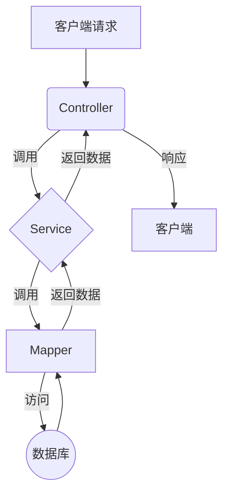

# 项目 API 开发文档

本文档旨在为开发者提供一个全面、清晰的 API 指南，帮助您快速理解项目架构、核心模型和 API 使用方法。

**目录**
- [1. 项目概述与文件结构](#1-项目概述与文件结构)
  - [1.1. 文件结构树](#11-文件结构树)
  - [1.2. 分层架构](#12-分层架构)
- [2. 核心领域模型 (DTO, Entity, VO)](#2-核心领域模型-dto-entity-vo)
  - [2.1. Entity (实体)](#21-entity-实体)
  - [2.2. DTO (数据传输对象)](#22-dto-数据传输对象)
  - [2.3. VO (视图对象)](#23-vo-视图对象)
- [3. Employer 模块详解](#3-employer-模块详解)
  - [3.1. API 端点](#31-api-端点)
    - [`GET /employer/list`](#get-employerlist)
    - [`GET /employer/detail`](#get-employerdetail)
    - [`POST /employer/create`](#post-employercreate)
    - [`POST /employer/update`](#post-employerupdate)
    - [`POST /employer/delete`](#post-employerdelete)
  - [3.2. 完整代码示例](#32-完整代码示例)
    - [`Employer.java` (Entity)](#employerjava-entity)
    - [`EmployerController.java`](#employercontrollerjava)
    - [`EmployerService.java`](#employerservicejava)
    - [`EmployerServiceImpl.java`](#employerserviceimpljava)
    - [`EmployerMapper.java`](#employermapperjava)
    - [`EmployerMapper.xml`](#employermapperxml)
    - [`EmployerController.http`](#employercontrollerhttp)
- [4. Salaryer 模块详解](#4-salaryer-模块详解)
  - [4.1. API 端点](#41-api-端点)
    - [`GET /salaryer/list`](#get-salaryerlist)
    - [`POST /salaryer/issue`](#post-salaryerissue)
    - [`POST /salaryer/delete`](#post-salaryerdelete)
  - [4.2. 完整代码示例](#42-完整代码示例)
    - [`Salaryer.java` (Entity)](#salaryerjava-entity)
    - [`SalaryerController.java`](#salaryercontrollerjava)
    - [`SalaryerService.java`](#salaryerservicejava)
    - [`SalaryerServiceImpl.java`](#salaryerserviceimpljava)
    - [`SalaryerMapper.java`](#salaryermapperjava)
    - [`SalaryerMapper.xml`](#salaryermapperxml)
    - [`SalaryerController.http`](#salaryercontrollerhttp)
- [5. 数据库与启动](#5-数据库与启动)
  - [5.1. 数据库初始化](#51-数据库初始化)
  - [5.2. 快速上手指南](#52-快速上手指南)

---

## 1. 项目概述与文件结构

本项目是一个基于 Java 的轻量级 Web 服务，用于管理雇主（Employer）和薪资（Salaryer）信息。它采用经典的三层架构模式，确保了代码的职责分离和可维护性。

### 1.1. 文件结构树

以下是项目核心源代码的结构树，展示了主要的包和文件组织方式：

```
src/main
├── java/cn/myslayers/app
│   ├── controller
│   │   ├── EmployerController.java
│   │   └── SalaryerController.java
│   ├── mapper
│   │   ├── xml
│   │   │   ├── EmployerMapper.xml
│   │   │   ├── SalaryerMapper.xml
│   │   ├── EmployerMapper.java
│   │   └── SalaryerMapper.java
│   ├── model
│   │   ├── dto
│   │   ├── entity
│   │   │   ├── Employer.java
│   │   │   └── Salaryer.java
│   │   └── vo
│   ├── service
│   │   ├── impl
│   │   │   ├── EmployerServiceImpl.java
│   │   │   └── SalaryerServiceImpl.java
│   │   ├── EmployerService.java
│   │   └── SalaryerService.java
│   └── LocalStarter.java
└── resources
    └── application.yml
```

### 1.2. 分层架构

其核心数据流如下：



- **Controller (控制器层)**: 负责接收和解析客户端的 HTTP 请求。
- **Service (业务逻辑层)**: 负责处理核心业务逻辑。
- **Mapper (数据访问层)**: 负责与数据库进行直接交互。

---

## 2. 核心领域模型 (DTO, Entity, VO)

在复杂的业务场景中，为了实现更好的分层和解耦，我们通常会引入 Entity、DTO 和 VO。

### 2.1. Entity (实体)

Entity 是领域模型的核心，它直接映射到数据库中的表结构，并包含了核心的业务属性和行为。

**示例**:
以 `Employer` 为例，它精确地定义了“雇主”在数据库中的存储结构。

```java
// src/main/java/cn/myslayers/app/model/entity/Employer.java
package cn.myslayers.app.model.entity;

import java.io.Serializable;

public class Employer implements Serializable {
    private static final long serialVersionUID = 1L;

    private String id;
    private String name;
    private String industry;

    // Getters and Setters
}
```

### 2.2. DTO (数据传输对象)

DTO 用于将客户端的请求数据聚合到一个对象中，它只包含业务操作所需的数据，从而避免暴露底层的领域模型。

**示例**:
假设我们有一个更复杂的“创建员工”操作，它可能需要来自不同领域（如 HR 和公司）的数据。

```java
// src/main/java/cn/myslayers/app/model/dto/hr/HrEmployeeDTO.java
package cn.myslayers.app.model.dto.hr;

public class HrEmployeeDTO {
    private String name;
    private String position;
    private String departmentId;
    // ... 其他 HR 相关字段
}

// src/main/java/cn/myslayers/app/model/dto/hs/HsCompanyDTO.java
package cn.myslayers.app.model.dto.hs;

public class HsCompanyDTO {
    private String companyName;
    private String legalEntity;
    // ... 其他公司相关字段
}
```

### 2.3. VO (视图对象)

VO 用于将服务端的响应数据封装成一个对前端友好的格式。它可以根据前端页面的展示需求，对多个领域模型的数据进行裁剪、聚合或格式化。

**示例**:
当薪资发放成功后，我们可能需要返回一个包含状态和多个关联信息的聚合对象。

```java
// src/main/java/cn/myslayers/app/model/vo/hs/SalarySaveResultVO.java
package cn.myslayers.app.model.vo.hs;

import java.math.BigDecimal;
import java.util.Date;

public class SalarySaveResultVO {
    private boolean success;
    private String message;
    private String salaryId;
    private String employeeName;
    private BigDecimal amount;
    private Date payDate;

    // Getters and Setters
}
```

> **当前项目状态**:
> 目前，为了简化，本项目在所有层之间直接使用 **Entity** 对象进行数据传输。在未来的迭代中，可以根据业务复杂性引入上述的 DTO 和 VO 模式。

---

## 3. Employer 模块详解

本模块负责管理所有与“雇主”相关的功能。

### 3.1. API 端点

#### `GET /employer/list`
- **功能**: 获取所有雇主信息。

#### `GET /employer/detail`
- **功能**: 根据 ID 获取单个雇主信息。
- **URL 参数**: `id` (String, 必需)

#### `POST /employer/create`
- **功能**: 创建一个新雇主。
- **请求体**: `Employer` 实体 (JSON)

#### `POST /employer/update`
- **功能**: 更新一个已存在的雇主信息。
- **请求体**: `Employer` 实体 (JSON)，`id` 字段为必需。

#### `POST /employer/delete`
- **功能**: 根据 ID 删除一个雇主。
- **请求体**: JSON 对象，包含 `id`。

### 3.2. 完整代码示例

<details>
<summary>点击展开/折叠 Employer 模块的完整源代码</summary>

#### `Employer.java` (Entity)
```java
package cn.myslayers.app.model.entity;

import java.io.Serializable;

public class Employer implements Serializable {
    private static final long serialVersionUID = 1L;

    private String id;
    private String name;
    private String industry;

    // Getters and Setters
    public String getId() {
        return id;
    }

    public void setId(String id) {
        this.id = id;
    }

    public String getName() {
        return name;
    }

    public void setName(String name) {
        this.name = name;
    }

    public String getIndustry() {
        return industry;
    }

    public void setIndustry(String industry) {
        this.industry = industry;
    }
}
```

#### `EmployerController.java`
```java
package cn.myslayers.app.controller;

import cn.myslayers.app.model.entity.Employer;
import cn.myslayers.app.service.EmployerService;
import cn.myslayers.app.service.impl.EmployerServiceImpl;
import cn.myslayers.app.utils.PostmanUtil;
import cn.myslayers.app.utils.PostmanUtil.PostmanController;
import cn.myslayers.app.utils.PostmanUtil.PostmanMapping;
import cn.myslayers.app.utils.PostmanUtil.RequestMethod;
import com.fasterxml.jackson.databind.ObjectMapper;
import java.util.List;
import java.util.Map;

// 雇主信息控制器
@PostmanController("/employer")
public class EmployerController extends PostmanUtil.BaseController {

    private final EmployerService employerService = new EmployerServiceImpl();
    private static final ObjectMapper objectMapper = new ObjectMapper();

    // 获取所有雇主信息
    @PostmanMapping(value = "/list", method = RequestMethod.GET)
    public PostmanUtil.Result<List<Employer>> getAllEmployers() {
        List<Employer> employers = employerService.getAllEmployers();
        return PostmanUtil.Result.ok(employers);
    }

    // 根据ID获取单个雇主信息
    @PostmanMapping(value = "/detail", method = RequestMethod.GET)
    public PostmanUtil.Result<Employer> getEmployerById() {
        String id = getParams().get("id");
        Employer employer = employerService.getEmployerById(id);
        if (employer == null) {
            return PostmanUtil.Result.error(404, "Employer not found with id: " + id);
        }
        return PostmanUtil.Result.ok(employer);
    }

    // 创建新雇主
    @PostmanMapping(value = "/create", method = RequestMethod.POST)
    public PostmanUtil.Result<Employer> createEmployer() {
        try {
            Employer employer = getBody(Employer.class);
            Employer createdEmployer = employerService.createEmployer(employer);
            return PostmanUtil.Result.ok(createdEmployer);
        } catch (Exception e) {
            return PostmanUtil.Result.error(400, "JSON解析或处理失败: " + e.getMessage());
        }
    }

    // 更新雇主信息
    @PostmanMapping(value = "/update", method = RequestMethod.POST)
    public PostmanUtil.Result<Employer> updateEmployer() {
        try {
            Employer employerDetails = getBody(Employer.class);
            String id = employerDetails.getId();
            if (id == null || id.isEmpty()) {
                return PostmanUtil.Result.error(400, "ID cannot be null or empty in request body for update.");
            }
            Employer updatedEmployer = employerService.updateEmployer(id, employerDetails);
            if (updatedEmployer == null) {
                return PostmanUtil.Result.error(404, "Employer not found with id: " + id);
            }
            return PostmanUtil.Result.ok(updatedEmployer);
        } catch (Exception e) {
            return PostmanUtil.Result.error(400, "JSON解析或处理失败: " + e.getMessage());
        }
    }

    // 删除雇主
    @PostmanMapping(value = "/delete", method = RequestMethod.POST)
    public PostmanUtil.Result<String> deleteEmployer() {
        try {
            Map<String, String> body = getBody(Map.class);
            String id = body.get("id");
            if (id == null || id.isEmpty()) {
                return PostmanUtil.Result.error(400, "ID cannot be null or empty in request body for delete.");
            }
            boolean deleted = employerService.deleteEmployer(id);
            if (!deleted) {
                return PostmanUtil.Result.error(404, "Employer not found with id: " + id);
            }
            return PostmanUtil.Result.ok("Employer with id " + id + " deleted successfully.");
        } catch (Exception e) {
            return PostmanUtil.Result.error(400, "JSON解析或处理失败: " + e.getMessage());
        }
    }
}
```

#### `EmployerService.java`
```java
package cn.myslayers.app.service;

import cn.myslayers.app.model.entity.Employer;
import java.util.List;

public interface EmployerService {
    List<Employer> getAllEmployers();
    Employer getEmployerById(String id);
    Employer createEmployer(Employer employer);
    Employer updateEmployer(String id, Employer employerDetails);
    boolean deleteEmployer(String id);
}
```

#### `EmployerServiceImpl.java`
```java
package cn.myslayers.app.service.impl;

import cn.myslayers.app.mapper.EmployerMapper;
import cn.myslayers.app.model.entity.Employer;
import cn.myslayers.app.service.EmployerService;
import cn.myslayers.app.utils.FactoryUtil;
import java.util.List;
import java.util.UUID;

public class EmployerServiceImpl implements EmployerService {

    private final EmployerMapper employerMapper = new EmployerMapper();

    @Override
    public List<Employer> getAllEmployers() {
        return employerMapper.findAll();
    }

    @Override
    public Employer getEmployerById(String id) {
        return employerMapper.findById(id);
    }

    @Override
    public Employer createEmployer(Employer employer) {
        employer.setId("emp-" + UUID.randomUUID().toString().substring(0, 8));
        employerMapper.insert(employer);
        return employer;
    }

    @Override
    public Employer updateEmployer(String id, Employer employerDetails) {
        Employer existingEmployer = employerMapper.findById(id);
        if (existingEmployer != null) {
            employerDetails.setId(id); // 确保ID一致
            employerMapper.update(employerDetails);
            return employerDetails;
        }
        return null;
    }

    @Override
    public boolean deleteEmployer(String id) {
        int affectedRows = employerMapper.delete(id);
        return affectedRows > 0;
    }
}
```

#### `EmployerMapper.java`
```java
package cn.myslayers.app.mapper;

import cn.myslayers.app.model.entity.Employer;
import java.util.List;

public interface EmployerMapper {
    List<Employer> findAll();
    Employer findById(String id);
    int insert(Employer employer);
    int update(Employer employer);
    int delete(String id);
}
```

#### `EmployerMapper.xml`
```xml
<?xml version="1.0" encoding="UTF-8" ?>
<!DOCTYPE mapper PUBLIC "-//mybatis.org//DTD Mapper 3.0//EN" "http://mybatis.org/dtd/mybatis-3-mapper.dtd">
<mapper namespace="cn.myslayers.app.mapper.EmployerMapper">

    <select id="findAll" resultType="cn.myslayers.app.model.entity.Employer">
        SELECT * FROM employers
    </select>

    <select id="findById" parameterType="string" resultType="cn.myslayers.app.model.entity.Employer">
        SELECT * FROM employers WHERE id = #{id}
    </select>

    <insert id="insert" parameterType="cn.myslayers.app.model.entity.Employer">
        INSERT INTO employers (id, name, industry) VALUES (#{id}, #{name}, #{industry})
    </insert>

    <update id="update" parameterType="cn.myslayers.app.model.entity.Employer">
        UPDATE employers SET name = #{name}, industry = #{industry} WHERE id = #{id}
    </update>

    <delete id="delete" parameterType="string">
        DELETE FROM employers WHERE id = #{id}
    </delete>

</mapper>
```

#### `EmployerController.http`
```http
### 1. 获取所有雇主 (预期返回2条记录)
GET http://localhost:5176/employer/list
Content-Type: application/json

### 2. 获取单个雇主 (获取预置的TechCorp)
GET http://localhost:5176/employer/detail?id=emp-001
Content-Type: application/json

### 3. 创建一个新雇主 "Innovate LLC"
POST http://localhost:5176/employer/create
Content-Type: application/json

{
  "name": "Innovate LLC",
  "industry": "AI Research"
}

### 4. 更新预置的雇主 "FinanceInc" 的信息
POST http://localhost:5176/employer/update
Content-Type: application/json

{
  "id": "emp-002",
  "name": "Finance & Global Partners",
  "industry": "Global Finance"
}

### 5. 删除一个雇主
POST http://localhost:5176/employer/delete
Content-Type: application/json

{
  "id": "emp-001"
}
```
</details>

---

## 4. Salaryer 模块详解

本模块负责管理所有与“薪资”相关的功能。

### 4.1. API 端点

#### `GET /salaryer/list`
- **功能**: 根据用户 ID 获取其所有薪资记录。
- **URL 参数**: `userId` (String, 必需)

#### `POST /salaryer/issue`
- **功能**: 发放一笔新薪水。
- **请求体**: `Salaryer` 实体 (JSON)。

#### `POST /salaryer/delete`
- **功能**: 根据 ID 删除一条薪资记录。
- **请求体**: JSON 对象，包含 `id`。

### 4.2. 完整代码示例

<details>
<summary>点击展开/折叠 Salaryer 模块的完整源代码</summary>

#### `Salaryer.java` (Entity)
```java
package cn.myslayers.app.model.entity;

import java.io.Serializable;
import java.math.BigDecimal;
import java.util.Date;

public class Salaryer implements Serializable {
    private static final long serialVersionUID = 1L;

    private String id;
    private String userId;
    private BigDecimal amount;
    private Date payDate;

    // Getters and Setters
    public String getId() {
        return id;
    }

    public void setId(String id) {
        this.id = id;
    }

    public String getUserId() {
        return userId;
    }

    public void setUserId(String userId) {
        this.userId = userId;
    }

    public BigDecimal getAmount() {
        return amount;
    }

    public void setAmount(BigDecimal amount) {
        this.amount = amount;
    }

    public Date getPayDate() {
        return payDate;
    }

    public void setPayDate(Date payDate) {
        this.payDate = payDate;
    }
}
```

#### `SalaryerController.java`
```java
package cn.myslayers.app.controller;

import cn.myslayers.app.model.entity.Salaryer;
import cn.myslayers.app.service.SalaryerService;
import cn.myslayers.app.service.impl.SalaryerServiceImpl;
import cn.myslayers.app.utils.PostmanUtil;
import cn.myslayers.app.utils.PostmanUtil.PostmanController;
import cn.myslayers.app.utils.PostmanUtil.PostmanMapping;
import cn.myslayers.app.utils.PostmanUtil.RequestMethod;
import com.fasterxml.jackson.databind.ObjectMapper;
import java.util.List;
import java.util.Map;

// 薪资业务控制器
@PostmanController("/salaryer")
public class SalaryerController extends PostmanUtil.BaseController {

    private final SalaryerService salaryerService = new SalaryerServiceImpl();

    // 根据用户ID获取薪资列表
    @PostmanMapping(value = "/list", method = RequestMethod.GET)
    public PostmanUtil.Result<List<Salaryer>> getSalariesByUserId() {
        String userId = getParams().get("userId");
        if (userId == null || userId.isEmpty()) {
            return PostmanUtil.Result.error(400, "User ID cannot be empty.");
        }
        List<Salaryer> salaries = salaryerService.getSalariesByUserId(userId);
        return PostmanUtil.Result.ok(salaries);
    }

    // 发放薪水
    @PostmanMapping(value = "/issue", method = RequestMethod.POST)
    public PostmanUtil.Result<Salaryer> issueSalary() {
        try {
            Salaryer salary = getBody(Salaryer.class);
            Salaryer issuedSalary = salaryerService.issueSalary(salary);
            return PostmanUtil.Result.ok(issuedSalary);
        } catch (Exception e) {
            // 捕获JSON解析异常和业务异常
            return PostmanUtil.Result.error(500, "Failed to issue salary: " + e.getMessage());
        }
    }

    // 删除薪资记录
    @PostmanMapping(value = "/delete", method = RequestMethod.POST)
    public PostmanUtil.Result<String> deleteSalary() {
        try {
            Map<String, String> body = getBody(Map.class);
            String id = body.get("id");
            if (id == null || id.isEmpty()) {
                return PostmanUtil.Result.error(400, "ID cannot be null or empty in request body for delete.");
            }
            boolean deleted = salaryerService.deleteSalary(id);
            if (!deleted) {
                return PostmanUtil.Result.error(404, "Salary record not found with id: " + id);
            }
            return PostmanUtil.Result.ok("Salary record with id " + id + " deleted successfully.");
        } catch (Exception e) {
            return PostmanUtil.Result.error(400, "JSON解析或处理失败: " + e.getMessage());
        }
    }
}
```

#### `SalaryerService.java`
```java
package cn.myslayers.app.service;

import cn.myslayers.app.model.entity.Salaryer;
import java.util.List;

public interface SalaryerService {
    List<Salaryer> getSalariesByUserId(String userId);
    Salaryer issueSalary(Salaryer salary);
    boolean deleteSalary(String id);
}
```

#### `SalaryerServiceImpl.java`
```java
package cn.myslayers.app.service.impl;

import cn.myslayers.app.mapper.SalaryerMapper;
import cn.myslayers.app.model.entity.Salaryer;
import cn.myslayers.app.service.SalaryerService;
import cn.myslayers.app.utils.FactoryUtil;
import java.util.List;
import java.util.UUID;

public class SalaryerServiceImpl implements SalaryerService {

    private final SalaryerMapper salaryerMapper = new SalaryerMapper();

    @Override
    public List<Salaryer> getSalariesByUserId(String userId) {
        return salaryerMapper.findByUserId(userId);
    }

    @Override
    public Salaryer issueSalary(Salaryer salary) {
        salary.setId("sal-" + UUID.randomUUID().toString().substring(0, 8));
        salaryerMapper.insert(salary);
        return salary;
    }

    @Override
    public boolean deleteSalary(String id) {
        int affectedRows = salaryerMapper.delete(id);
        return affectedRows > 0;
    }
}
```

#### `SalaryerMapper.java`
```java
package cn.myslayers.app.mapper;

import cn.myslayers.app.model.entity.Salaryer;
import java.util.List;

public interface SalaryerMapper {
    List<Salaryer> findByUserId(String userId);
    int insert(Salaryer salary);
    int delete(String id);
}
```

#### `SalaryerMapper.xml`
```xml
<?xml version="1.0" encoding="UTF-8" ?>
<!DOCTYPE mapper PUBLIC "-//mybatis.org//DTD Mapper 3.0//EN" "http://mybatis.org/dtd/mybatis-3-mapper.dtd">
<mapper namespace="cn.myslayers.app.mapper.SalaryerMapper">

    <select id="findByUserId" parameterType="string" resultType="cn.myslayers.app.model.entity.Salaryer">
        SELECT * FROM salaryers WHERE user_id = #{userId}
    </select>

    <insert id="insert" parameterType="cn.myslayers.app.model.entity.Salaryer">
        INSERT INTO salaryers (id, user_id, amount, pay_date) VALUES (#{id}, #{userId}, #{amount}, #{payDate})
    </insert>

    <delete id="delete" parameterType="string">
        DELETE FROM salaryers WHERE id = #{id}
    </delete>

</mapper>
```

#### `SalaryerController.http`
```http
### 1. 根据用户ID获取薪资列表 (预期返回2条记录)
GET http://localhost:5176/salaryer/list?userId=user-123
Content-Type: application/json

### 2. 为另一个用户发放一笔新薪水
POST http://localhost:5176/salaryer/issue
Content-Type: application/json

{
  "userId": "user-456",
  "amount": 8200.50,
  "payDate": "2025-08-15"
}

### 3. 删除一条预置的薪资记录
POST http://localhost:5176/salaryer/delete
Content-Type: application/json

{
  "id": "sal-003"
}
```
</details>

---

## 5. 数据库与启动

### 5.1. 数据库初始化
为了方便开发和测试，项目在每次启动时都会通过 `LocalStarter.java` 自动初始化数据库，包括重建表和插入以下初始数据：
- **employers**:
  - `('emp-001', 'TechCorp', 'Technology')`
  - `('emp-002', 'FinanceInc', 'Finance')`
- **salaryers**:
  - `('sal-001', 'user-123', 5000.00, '2025-07-01')`
  - `('sal-002', 'user-123', 5100.00, '2025-08-01')`
  - `('sal-003', 'user-456', 8000.00, '2025-07-15')`

### 5.2. 快速上手指南
1.  **启动服务**: 在 IDE 中运行 `cn.myslayers.app.LocalStarter.java` 的 `main` 方法。
```java
package cn.myslayers.app;

import cn.myslayers.app.utils.DatabaseUtil;
import cn.myslayers.app.utils.PostmanUtil;
import cn.myslayers.app.utils.PostmanUtil.HttpCore;
import cn.myslayers.app.utils.PostmanUtil.ManualRegistry;

public class LocalStarter {
    public static void main(String[] args) {
        System.out.println("=== PostmanUtil [全局模式] 启动 ===");

        // 初始化数据库
        initializeDatabase();

        // 设置端口
        PostmanUtil.setPort(5176);

        // 开启核心调试日志 (服务器启动、扫描等)
        PostmanUtil.setDebugLogEnabled(true);
        // 开启启动时打印的接口列表
        PostmanUtil.setStartupLogEnabled(true);
        // 开启请求详情日志 (curl、出入参等)
        PostmanUtil.setRequestDetailLogEnabled(true);

        // 设置普通日志开关
//        DatabaseUtil.LoggerCore.setDebugLogEnabled(true);
        // 检查普通日志开关状态
//        DatabaseUtil.LoggerCore.setSqlDebugLogEnabled(true);

        // 在全局模式下，明确指定扫描Controller所在的包
        ManualRegistry.scan("cn.myslayers.app.controller");

        // 启动服务器
        HttpCore.startServer();
        Runtime.getRuntime().addShutdownHook(new Thread(() -> {

            System.out.println("\n正在关闭Postman测试工具...");
            HttpCore.stopServer();
        }));
        try {
            Thread.currentThread().join();
        } catch (InterruptedException e) {
            HttpCore.stopServer();
        }
    }

    private static void initializeDatabase() {
        System.out.println("--- 正在初始化数据库 ---");
        try {
            // 安全删除旧表
            DatabaseUtil.executeDDL("DROP TABLE IF EXISTS salaries;");
            DatabaseUtil.executeDDL("DROP TABLE IF EXISTS employers;");
            System.out.println("旧表已删除。");

            // 创建 employers 表
            DatabaseUtil.executeDDL(
                "CREATE TABLE employers (" +
                "    id VARCHAR(255) PRIMARY KEY," +
                "    name VARCHAR(255) NOT NULL," +
                "    industry VARCHAR(255)" +
                ");"
            );
            System.out.println("表 'employers' 已创建。");

            // 创建 salaries 表
            DatabaseUtil.executeDDL(
                "CREATE TABLE salaries (" +
                "    id VARCHAR(255) PRIMARY KEY," +
                "    user_id VARCHAR(255) NOT NULL," +
                "    amount DECIMAL(10, 2) NOT NULL," +
                "    pay_date DATE NOT NULL" +
                ");"
            );
            System.out.println("表 'salaries' 已创建。");

            // 插入初始数据
            DatabaseUtil.executeDDL("INSERT INTO employers (id, name, industry) VALUES ('emp-001', 'TechCorp', 'Technology');");
            DatabaseUtil.executeDDL("INSERT INTO employers (id, name, industry) VALUES ('emp-002', 'FinanceInc', 'Finance');");
            DatabaseUtil.executeDDL("INSERT INTO salaries (id, user_id, amount, pay_date) VALUES ('sal-001', 'user-123', 5000.00, '2025-07-01');");
            DatabaseUtil.executeDDL("INSERT INTO salaries (id, user_id, amount, pay_date) VALUES ('sal-002', 'user-123', 5100.00, '2025-08-01');");
            DatabaseUtil.executeDDL("INSERT INTO salaries (id, user_id, amount, pay_date) VALUES ('sal-003', 'user-456', 8000.00, '2025-07-15');");
            System.out.println("初始数据已插入。");

            System.out.println("--- 数据库初始化完成 ---");
        } catch (Exception e) {
            System.err.println("数据库初始化失败: " + e.getMessage());
            e.printStackTrace();
        }
    }
}

```
2.  **测试 API**: 打开 `.http` 文件 (如 `EmployerController.http`)，点击 "Send Request" 即可测试对应的 API。
